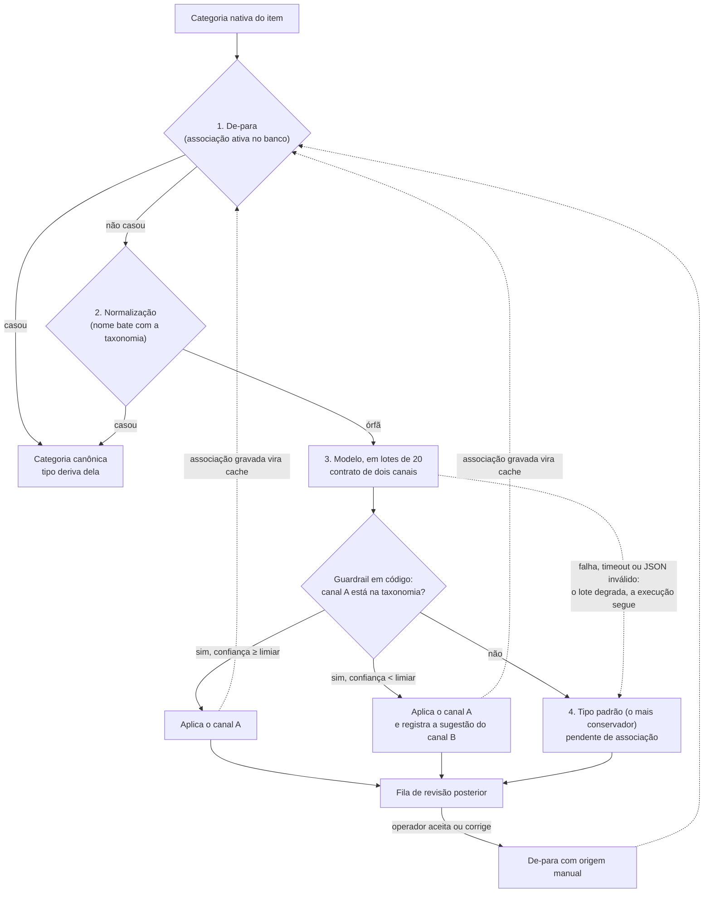
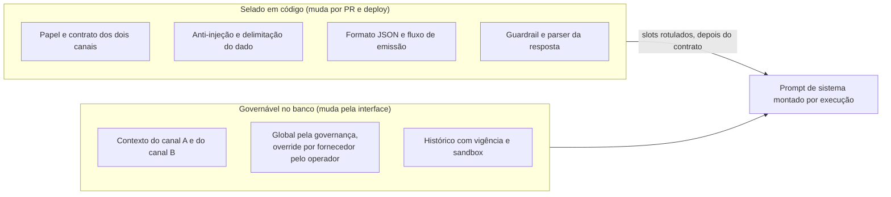

## O problema

Um sistema de catálogo de uma organização recebe, a cada ciclo, os catálogos de vários fornecedores, e cada item precisa sair classificado numa taxonomia canônica da organização, uma taxonomia curta, da ordem de uma dezena de categorias, cada uma com um tipo fixo, de modo que o item herda o tipo da categoria [ref:classificacao-hibrida-adr-configuracao-governada]. Antes do módulo, essa classificação vivia em dois lugares frágeis: cerca de 250 linhas de de-para no código dos extratores, em que cada serviço novo exigia um commit, e arquivos de regras que só um desenvolvedor editava [ref:classificacao-hibrida-adr-configuracao-governada]. A organização pôs duas exigências na mesa: mudar uma classificação tem de ser edição de dado, sem deploy, feita por ela mesma pela interface, inclusive o prompt do modelo [ref:classificacao-hibrida-adr-configuracao-governada]; e o catálogo nunca pode parar nem atrasar por causa de item que ninguém classificou ainda [ref:classificacao-hibrida-adr-tipo-padrao].

As duas exigências puxam para lados opostos. Um modelo resolve o que o de-para não cobre, mas erra, fica fora do ar e muda de comportamento quando alguém edita o prompt. O desenho a que o time chegou, em seis ADRs escritas de 2026-06-22 a 2026-06-26 e uma sétima em 2026-08-06, é uma composição de cinco padrões em que o modelo é só uma etapa da cascata, e o catálogo sai mesmo quando essa etapa falha [ref:classificacao-hibrida-adr-modelo-no-caminho] [ref:classificacao-hibrida-adr-contrato-selado] [ref:classificacao-hibrida-adr-publicacao-imutavel].

## O desenho composto

*A cascata do motor de classificação: o determinístico resolve primeiro; o modelo só vê as órfãs; o guardrail e o limiar decidem o que entra; a falha cai no tipo padrão; a revisão vem depois e realimenta o de-para, que serve de cache na execução seguinte.*

### Cascata com limiar de confiança

A cascata tem quatro etapas: de-para, normalização, modelo e tipo padrão [ref:classificacao-hibrida-adr-camada-de-regras]. As duas primeiras são determinísticas: o de-para busca a categoria nativa normalizada nas associações ativas, e a normalização tenta o nome contra as categorias canônicas; o que não casa sai como órfã para o chamador [ref:classificacao-hibrida-codigo-cascata]. O modelo responde por um contrato de dois canais: o canal A é a melhor correspondência na taxonomia existente, com uma confiança de 0 a 1, e o canal B é a sugestão de uma categoria nova, que nunca é criada sozinha [ref:classificacao-hibrida-adr-contrato-selado].

O limiar padrão é 0,6, e um parâmetro no banco o substitui, com o valor por fornecedor prevalecendo sobre o global [ref:classificacao-hibrida-codigo-cascata]. No commit lido, o canal A válido é aplicado como melhor palpite mesmo abaixo do limiar; o limiar decide se a sugestão do canal B é registrada para revisão junto com a associação [ref:classificacao-hibrida-codigo-cascata]. A ADR de 2026-06-26 fez desse limiar a única alavanca de sensibilidade, depois que o time viu que o texto do prompt e o controle deslizante da interface eram duas alavancas desconectadas [ref:classificacao-hibrida-adr-contrato-selado]. Quando o mesmo padrão foi para um segundo módulo do sistema, o de unidades de medida, em 2026-06-29, a política ficou mais conservadora: ali o canal A só se aplica sozinho com confiança igual ou acima do limiar e sem juízo de conversão, e todo o resto vai para a fila [ref:classificacao-hibrida-segundo-modulo].

### O modelo não bloqueia o pipeline

Até a fase anterior, o modelo era uma segunda passada disparada à mão, e o valor dele dependia de alguém lembrar de acioná-lo [ref:classificacao-hibrida-adr-modelo-no-caminho]. A decisão de pô-lo no caminho crítico veio junto com a regra que a tornou aceitável: qualquer falha da chamada degrada o lote para o tipo padrão, marcado como pendente, e a execução segue; falhar a execução inteira e pôr um gate humano antes de aplicar foram alternativas rejeitadas [ref:classificacao-hibrida-adr-modelo-no-caminho]. O tipo padrão é o mais conservador, para que a dúvida fique com o tipo que menos compromete, e o item provisório entra no arquivo e na fila de revisão [ref:classificacao-hibrida-adr-tipo-padrao].

No código, os erros transitórios têm retry com backoff e o retry não repete erros de programação; mas a guarda externa, tanto no laço dos lotes quanto no núcleo do motor, captura qualquer exceção e ainda degrada o lote para o tipo padrão [ref:classificacao-hibrida-codigo-cascata] [ref:classificacao-hibrida-codigo-contrato]. Um teste simula o timeout do modelo e confere que as categorias saem com o tipo padrão e status pendente, sem exceção [ref:classificacao-hibrida-testes]. Uma flag de configuração desliga a etapa e deixa a cascata inteiramente determinística [ref:classificacao-hibrida-codigo-cascata].

### Cache de decisão

O de-para é o cache. Uma associação que o modelo gravou numa execução resolve na primeira etapa da execução seguinte, sem nova chamada, e a revisão do operador também termina no de-para, com origem manual [ref:classificacao-hibrida-adr-modelo-no-caminho]. Por isso o modelo só toca categorias novas, que são dezenas por execução, mesmo em catálogos de centenas de milhares a cerca de um milhão de itens [ref:classificacao-hibrida-spec-modelo-no-caminho]. O teste do cache conta as chamadas ao modelo simulado: uma na primeira execução, e a contagem continua em uma depois da segunda [ref:classificacao-hibrida-testes]. O preço anotado na ADR é um churn de metadado: a reclassificação troca a origem do item de "modelo" para "de-para", com a resolução correta e menos fidelidade de proveniência [ref:classificacao-hibrida-adr-modelo-no-caminho].

### Contrato selado em código, contexto governável

*A fronteira entre o que é selado em código e o que o operador afina sem deploy, como ficou na ADR de 2026-06-26.*

Toda a configuração de classificação, prompt incluído, foi para o banco com histórico de vigência, para que a organização a editasse sem deploy e para que um catálogo antigo pudesse ser reprocessado com a configuração vigente na época [ref:classificacao-hibrida-adr-configuracao-governada]. Já na primeira ADR, o contrato de saída ficou fora do prompt, validado em código [ref:classificacao-hibrida-adr-configuracao-governada]. O que faltava era a fronteira dentro do texto: o prompt editável misturava contexto, contrato, fluxo de emissão, anti-injeção e formato, e só o primeiro era de fato contexto [ref:classificacao-hibrida-adr-contrato-selado]. A ADR de 2026-06-26 alinhou a fronteira código × banco à fronteira contrato × contexto: um esqueleto selado em código traz papel, contrato, anti-injeção, formato e fluxo, e o contexto de cada canal entra em slots delimitados e rotulados [ref:classificacao-hibrida-adr-contrato-selado] [ref:classificacao-hibrida-codigo-contrato]. O registro global exige o papel de governança, e o override por fornecedor exige operador autenticado [ref:classificacao-hibrida-adr-contrato-selado].

O guardrail está no código: o nome do canal A é comparado com a taxonomia viva e, fora dela, é descartado; o canal B só passa com tipo válido; as categorias nativas são sanitizadas e envelopadas como dado não confiável [ref:classificacao-hibrida-codigo-contrato]. Sem contexto no banco, o esqueleto ainda compõe um prompt válido [ref:classificacao-hibrida-codigo-contrato]. Testes conferem que o esqueleto carrega o fluxo de emissão e que o contexto de cada canal entra no slot certo [ref:classificacao-hibrida-testes].

### Saída publicada imutável

A última peça veio seis semanas depois, com a ADR de 2026-08-06. Até ali, o catálogo público mudava em silêncio: toda execução que gerava arquivo reescrevia o manifesto público, sem ato de publicar e sem histórico [ref:classificacao-hibrida-adr-publicacao-imutavel]. A ADR separou gerar de publicar: a execução produz um candidato, e publicar é um ato explícito, registrado num banco que guarda versão, checksum SHA-256, autor e data, enquanto o objeto congelado fica numa chave que jamais é sobrescrita; correção entra como versão nova [ref:classificacao-hibrida-adr-publicacao-imutavel]. Uma falha entre copiar o objeto e gravar a linha deixa um órfão, e o checksum decide: idêntico, regrava; divergente, aborta [ref:classificacao-hibrida-adr-publicacao-imutavel] [ref:classificacao-hibrida-codigo-publicacao]. É o que dá sentido à revisão posterior da cascata: o erro do modelo pode chegar a um candidato, mas a versão publicada e citada por terceiros não muda depois.

## O que foi medido

- **Volume e custo.** O cache pelo de-para limita o modelo às categorias novas, dezenas por execução, em catálogos de centenas de milhares a cerca de um milhão de itens [ref:classificacao-hibrida-spec-modelo-no-caminho].
- **Lote contra limite de saída.** Um lote de 78 categorias estourou o limite de saída do modelo; a correção fixou lotes de 20 e um teto de 4.096 tokens [ref:classificacao-hibrida-commits-lote-e-reserva].
- **Lote contra timeout.** No segundo módulo, 20 grupos a cerca de 3,3 s cada passaram do timeout de 30 s, e o lote inteiro degradou; a regra que ficou foi tamanho do lote × custo unitário abaixo do timeout, os dois configuráveis [ref:classificacao-hibrida-licoes].
- **Cobertura determinística.** Depois da correção do classificador, um dos fornecedores passou a ser classificado 100% pelo de-para, com zero órfãs [ref:classificacao-hibrida-licoes].
- **Testes.** No commit lido, o módulo de classificação tem 391 funções de teste em 48 arquivos, e o serviço de publicação, 88 em 8 [ref:classificacao-hibrida-testes].

O que não foi medido é a qualidade do modelo. Os testes do motor simulam a chamada e provam o comportamento da cascata, e a busca nas specs, nos planos e nos testes da classificação não achou conjunto de avaliação da qualidade das respostas [ref:classificacao-hibrida-testes]. A qualidade ficou a cargo do sandbox do prompt e da fila de revisão [ref:classificacao-hibrida-adr-camada-de-regras] [ref:classificacao-hibrida-adr-tipo-padrao].

## O que deu errado

- **Uma camada construída e nunca usada.** A tabela de regras por sinais, entre a normalização e o modelo, ficou vazia em operação real, e o eixo dela estava errado para um modelo de negócio em que o tipo deriva da categoria; foi removida por inteiro, com migration reversível [ref:classificacao-hibrida-adr-camada-de-regras].
- **O prompt editável misturava contrato e contexto.** Uma correção de comportamento exigiu deploy, o texto do banco ficou com fraseado antigo, e a ADR de 2026-06-25 foi substituída no dia seguinte pela que selou o contrato em código [ref:classificacao-hibrida-adr-contrato-selado]. A própria ADR registra o risco que motivou a mudança: contrato quebrado faz o parser falhar e tudo degradar para o tipo padrão em silêncio [ref:classificacao-hibrida-adr-contrato-selado].
- **A degradação segura escondeu falhas.** O lote de 78 categorias truncou, o JSON ficou inválido e toda órfã virou tipo padrão sem erro aparente; e o modelo primário, em lotes grandes, às vezes não emitia nenhum dos dois canais, o que levou ao modelo de reserva, desligado por padrão e restrito às não resolvidas [ref:classificacao-hibrida-commits-lote-e-reserva]. Uma variável de ambiente redeclarada como vazia no compose zerou o nome do modelo e degradou os atores de modelo [ref:classificacao-hibrida-licoes]. E a guarda externa da chamada captura qualquer exceção: um erro de programação que escape do retry também vira lote degradado, e o bug aparece como órfãs no tipo padrão, não como falha [ref:classificacao-hibrida-codigo-contrato] [ref:classificacao-hibrida-codigo-cascata]. "Nunca bloquear" precisa de um sinal de que se está degradando; a ADR conta com a fila e com as métricas de cobertura para isso [ref:classificacao-hibrida-adr-modelo-no-caminho].
- **Um extrator contornava o motor.** Ele gravava a categoria nativa no lugar da canônica, e o sintoma eram várias vezes mais categorias distintas nesse fornecedor que as canônicas dos outros [ref:classificacao-hibrida-licoes].
- **O cache da borda ignorava a versão.** A política de cache sem a query string na chave serviria a versão vigente para qualquer versão pedida; a imutabilidade só fecha com uma política dedicada e com `immutable` na resposta versionada [ref:classificacao-hibrida-adr-publicacao-imutavel].

## O que o time repetiu e registrou como regra

O sinal mais forte de que o desenho funcionou é que o time o levou para um segundo módulo, com o mesmo contrato de dois canais, o mesmo limiar e uma política de aplicação mais conservadora [ref:classificacao-hibrida-segundo-modulo]. As lições do primeiro uso real desse módulo viraram regra na memória do projeto: dimensionar o lote pelo timeout, nunca chamar o modelo dentro do request HTTP (fila, 202 e polling) e casar a resposta com o vocabulário antes de tratá-la como novidade [ref:classificacao-hibrida-licoes]. E a regra de que todo extrator passa pelo motor ficou no steering [ref:classificacao-hibrida-licoes].

Para quem vai copiar o desenho, três leituras deste caso, que são do curador e não do time: decida o limiar e a política de aplicação pelo custo do erro em cada domínio, como o segundo módulo fez; trate a degradação como um evento observável, com contagem e alerta, e não só como um caminho seguro; e meça a qualidade do modelo com um conjunto de avaliação antes de confiar na fila para achar os erros.

## As práticas do catálogo que o caso exemplifica

- [ARQ-01](../praticas/ARQ-01.html): sete ADRs no período, com alternativas rejeitadas, e uma substituída no dia seguinte por escrito, em vez de revertida em silêncio [ref:classificacao-hibrida-adr-contrato-selado] [ref:classificacao-hibrida-adr-publicacao-imutavel].
- [P3-05](../praticas/P3-05.html): as categorias nativas entram sanitizadas e delimitadas como dado não confiável, e a instrução de ignorar comandos dentro delas está no esqueleto selado, fora do alcance do operador [ref:classificacao-hibrida-codigo-contrato].
- [QLD-02](../praticas/QLD-02.html): o truncamento do lote e a ausência dos dois canais viraram correção com teste, de particionamento e de reserva [ref:classificacao-hibrida-commits-lote-e-reserva] [ref:classificacao-hibrida-testes].
- [P2-05](../praticas/P2-05.html): é a lacuna do caso; os testes provam a cascata com o modelo simulado, e não havia eval da qualidade das respostas [ref:classificacao-hibrida-testes].
- [CICD-03](../praticas/CICD-03.html): a mesma ideia de artefato rastreável, aplicada à saída do produto: versão, checksum, autor e data de cada publicação [ref:classificacao-hibrida-adr-publicacao-imutavel].

Duas práticas da Onda 1 do programa de Engenharia de IA, em redação, têm aqui a âncora natural: a P2-08, prompt e configuração de modelo como artefato versionado, com contrato selado em código e contexto governável, e a P2-09, trabalho de modelo fora do request, com lote × custo unitário abaixo do timeout [ref:classificacao-hibrida-adr-contrato-selado] [ref:classificacao-hibrida-licoes].

## O que ficou fora

O material publicado é sanitizado: nenhum trecho cita a organização, o sistema, os fornecedores, o modelo usado, pessoas, hosts ou dados do projeto de origem, e os trechos de código foram redigidos com nomes neutros. Os números são os do commit fixado no registro de verificação, lido em 2026-11-03. O arquivamento do dado bruto com rastreabilidade por linha, que o projeto também pratica, fica para outro caso.
