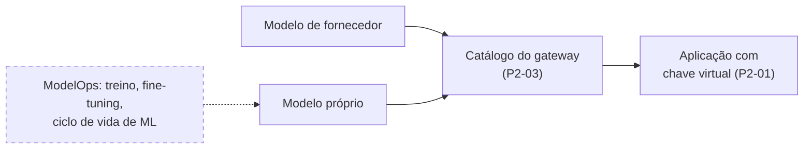

# ADR 0013: ModelOps fica fora do escopo; modelo próprio entra pelo catálogo do gateway

**Data:** 2026-10-28 · **Status:** aceita · **Spec:**
`docs/specs/2026-10-28-programa-engenharia-de-ia-delta.md` (PE-D3, R2) · **Origem:** decisão do
dono em 2026-10-28

## Contexto

O programa Engenharia de IA cobre o ciclo de software com IA: pilotos, gateway, contratos, práticas
por força e medição. Treinar, ajustar e operar modelos próprios (ModelOps, o ciclo de vida do ML
tradicional) é outra disciplina, com ferramentas, riscos e donos diferentes. Cobri-la no mesmo
portal diluiria o foco e prometeria um padrão que o repositório não tem como manter.

Ao mesmo tempo, algum departamento pode ter um modelo próprio e querer que aplicações o consumam. A
prática P2-03 já define o que precisa estar registrado para qualquer modelo, em cada canal de
consumo: operador dos dados, retenção, ZDR, system card, certificações e vedação de treinamento.
Esses metadados servem a um modelo próprio como servem a um de fornecedor.

## Decisão

1. **Treino, fine-tuning e ciclo de vida de ML tradicional ficam fora do portal (PE-D3).** O
   programa não publica prática, guia nem verificador para essas etapas.
2. **Modelo próprio, de qualquer departamento, só é consumido se entrar no catálogo do gateway**
   com os metadados da P2-03: operador dos dados, retenção, ZDR, system card, certificações e
   vedação de treinamento. Sem a entrada no catálogo, nenhuma aplicação o usa.
3. **O caminho de consumo é o mesmo do modelo de fornecedor:** catálogo do gateway (P2-03) e
   aplicação com chave virtual (P2-01). O que acontece antes do catálogo é problema de quem
   mantém o modelo.

*Modelo de fornecedor e modelo próprio chegam à aplicação pelo mesmo catálogo; o ModelOps, tracejado, fica fora do portal.*

## Consequências

- O §19 da spec v1.0 ganha o item que registra a exclusão, sem outra alteração na spec.
- Quem tiver modelo próprio cumpre a P2-03 como qualquer fornecedor; onde o fornecedor publica
  system card ou certificação, o time do modelo próprio produz o equivalente ou registra a lacuna
  na entrada do catálogo.
- Nenhum esquema, validador ou prática muda por esta decisão.
- Se um dia o ModelOps entrar no escopo, vale nova ADR que substitua esta, com a spec que a
  sustente.
