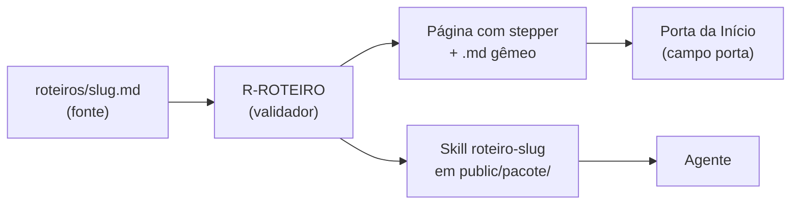

# ADR 0014: O roteiro é um tipo de conteúdo e vira skill gerada no pacote

**Data:** 2026-11-04 · **Status:** aceita · **Spec:**
`docs/specs/2026-11-03-primeiro-dia-com-o-agente-delta.md` (PD-D1, PD-D5) · **Origem:** decisão do
autor da spec, com o dono

## Contexto

O portal explica o que fazer (práticas, guias, trilha) e como fazer uma coisa concreta (receitas),
mas não conduz o primeiro dia de um time num projeto. A pessoa lê o guia, abre o agente, cola um
prompt solto e perde a ordem dos passos. O que falta é uma sequência com dono de cada passo (a
pessoa, o agente ou a decisão compartilhada), que a pessoa leia e o agente execute a partir da
mesma fonte.

Os tipos existentes não servem. A receita é um procedimento único e curto; o guia é texto de leitura;
a trilha é um mapa de caminhos. Nenhum deles carrega a ordem dos passos, o quem faz e o que muda por
harness. Colocar isso num guia deixaria o gerador sem como validar a estrutura e sem como entregá-la
ao agente.

Para o agente, o roteiro precisa estar onde ele já procura instruções: uma skill do pacote de
distribuição. Mas `skills/` do repositório é de risco alto (duas aprovações) e guarda cópias com
procedência, não conteúdo gerado.

## Decisão

1. **O roteiro é um tipo de conteúdo novo (PD-D1).** A fonte fica em `roteiros/<slug>.md`, com
   schema `esquemas/roteiro.schema.json` (frontmatter com `porta`, `harnesses` e `passos`
   `{titulo, quem}`), página em `roteiros/<slug>.html` com `.md` gêmeo e seção "Roteiros" no
   `llms.txt`. A regra `R-ROTEIRO` confere que o corpo tem o prompt inicial e uma seção
   `## Passo N: Título` por passo, na mesma ordem. Risco médio, como a receita.
2. **O roteiro vira skill no pacote, e não em `skills/` (PD-D5).** Para cada roteiro, o gerador
   emite `skills/roteiro-<slug>/SKILL.md` dentro de `public/pacote/`, com `name`, `description` (o
   objetivo) e o corpo do roteiro. A fonte continua sendo o `.md`; nada é escrito em `skills/` do
   repositório, e o manifesto do pacote cobre a skill gerada como cobre as demais.
3. **O campo `porta` liga o roteiro à Início.** O casamento entre porta e roteiro é só por esse
   campo, que `pagina.schema.json` passa a aceitar de forma opcional; nenhum título ou destino é
   comparado.

*Uma fonte, três saídas: a página para a pessoa, a skill para o agente e a porta que leva ao roteiro.*

## Consequências

- Mudança aditiva em `pagina.schema.json` e esquema novo: SemVer minor (ADR 0007). A versão em
  `portal/config.yml` só muda na tag da release.
- Quem edita um roteiro altera uma só fonte; a skill do pacote nunca diverge da página, porque as
  duas saem do mesmo `.md`.
- `skills/` do repositório continua sem conteúdo gerado e sem mudança de risco.
- O `scripts/validar.py` passa a exigir, em cada prompt do roteiro, execução registrada
  (`R-PROMPT`), como nas receitas. O dono executa os prompts antes de integrar.
- Um terceiro roteiro (o da porta "No meio de uma mudança") entra sem nova ADR, só com
  conteúdo; mudar a estrutura do roteiro ou a forma de emitir a skill pede nova ADR.
