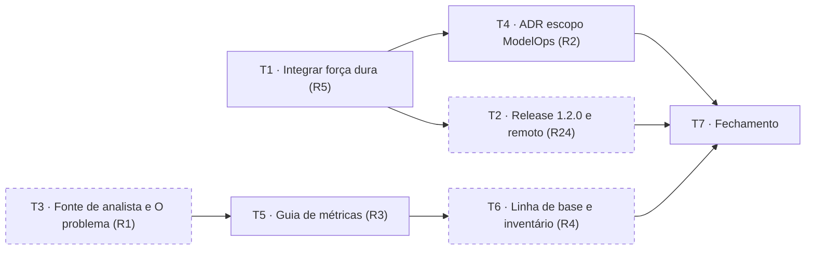

# Programa Engenharia de IA, Onda 0: plano de implementação

> **Para workers agênticos:** SUB-SKILL OBRIGATÓRIA: use `superpowers:subagent-driven-development`
> (recomendado) ou `superpowers:executing-plans` para implementar este plano tarefa a tarefa. Os
> passos usam checkbox (`- [ ]`). O rastreamento vive só aqui (AGENTS.md, princípio 2).

**Objetivo:** fechar a Onda 0 do programa: integrar a rodada de força dura, publicar a versão 1.2.0
com remoto no GitLab, enquadrar o problema com a fonte de analista, registrar o escopo de ModelOps
em ADR, publicar as métricas e colher a linha de base nos dois pilotos.

**Arquitetura:** só conteúdo, ADR, release e integração de branch já pronta. Nenhuma mudança em
`esquemas/` ou em `portal/gerador/`: a página de métricas é um guia (tipo `explicacao`), o elo e o
número entram nos blocos que "O problema" já tem, e os verificadores da força dura já existem em
`verificadores/` com testes.

**Stack:** Python 3.11+, PyYAML, Jinja2, jsonschema, pytest, ruff; GitLab CI. Diagramas em Mermaid.

**Spec:** [`2026-10-28-programa-engenharia-de-ia-delta.md`](../specs/2026-10-28-programa-engenharia-de-ia-delta.md),
aprovada em 2026-10-28. Requisitos desta onda: R1, R2, R3, R4, R5, R24, R25.

**Tier:** 2. **Branch:** `feat/2026-10-28-programa-engenharia-de-ia` (tarefas 2 a 7); a tarefa 1
roda na worktree `../padroes-engenharia-curadoria` (branch `feat/2026-10-08-curadoria-forca-dura`).



*Figura 1. Dependências entre as tarefas. Tracejadas: têm passo que só o dono ou os times piloto
fazem.*

## Restrições globais

- Português do Brasil em tudo; nenhuma marca de assistente em artefato ou commit; commits **sem**
  linha `Co-Authored-By` (regra do dono).
- Nenhum nome de órgão, departamento, sistema de origem ou pessoa fora do campo `Aprovado por`
  (PE-D10). Varredura manual com a lista fora do repositório antes de cada commit que publica dado
  de piloto (PE-D16).
- Vocabulário de força: `bloqueia | pede-aprovacao | avisa | orienta`.
- Nunca editar `public/`, `README.md` nem `ROTEAMENTO.md` à mão: `python scripts/gerar.py` os
  regenera. Antes de cada commit: `.venv/bin/python scripts/validar.py` e `gerar.py` com saída 0.
- `esquemas/`, `scripts/`, `portal/`, `constituicao/` e `skills/` são risco alto: este plano não os
  toca; se uma tarefa precisar, pare e volte à spec (princípio 4).
- Toda afirmação factual em conteúdo cita `[ref:<id>]` com registro em `verificacoes/`.
- A fonte de analista é lida e conferida só pelo dono (PE-D15); o agente não abre o documento.
- Documento novo do programa leva frontmatter YAML (`id`, `titulo`, `type`, `status`, `onda`,
  `dono`, `revisado_em`, `verified`, `stale_after`, `sources`, `relacionados`) e ao menos um
  diagrama Mermaid (R25). Conteúdo do portal (`guias/`, `paginas/`) segue o schema dele, não esse
  frontmatter.

## Foco de revisão

1. **Conflito resolvido escolhendo um lado.** As 4 práticas em conflito (CICD-02, API-02, LGPD-02,
   SEG-02) precisam sair com o `marco` da trilha v3 **e** o bloco `mecanismo` da força dura; as 4
   verificações, com a união das afirmações. Teste na T1, passo 5.
2. **ADR renumerada com referência pendurada.** Depois de mover a ADR 0010 da branch para 0012,
   nenhum arquivo pode citar "ADR 0010" querendo dizer verificadores internos. Teste na T1, passo 7.
3. **Tag sem a versão.** O job `pacote` reprova se `v<versao>` de `portal/config.yml` não bater com
   a tag. Teste na T2, passo 4.
4. **Texto além da licença.** O portal parafraseia a fonte de analista em no máximo uma frase por
   afirmação e cita URL e ID; nada é transcrito. Teste na T3, passo 6.
5. **Número inventado nas métricas.** O guia publica definição, unidade e onde é medida; linha de
   base e meta só aparecem depois de coletadas (T6). Teste na T5, passo 4.

## Impacto Arquitetural

- Conteúdo: 1 referência, 1 elo e 1 número em "O problema", 1 guia, 1 ADR, 1 linha na spec v1.0
  §19, CHANGELOG.
- Integração: 7 práticas sobem de força (1 `bloqueia`, 2 `pede-aprovacao`, 4 `avisa`), 7
  verificadores em `verificadores/`, `gatilhos.py` e `pacote.py` do gerador já alterados na branch
  (revisados na T1, não reescritos).
- Operação: remoto no GitLab, tag `v1.2.0`, pacote como artefato do job `pacote`.
- Nada em `esquemas/`. SemVer: minor (conteúdo novo e força nova, aditivos), pela ADR 0007.

---

### Tarefa 1: Integrar a rodada de força dura (R5)

**Arquivos:**
- Worktree: `/Users/thiago/Documents/Workspace/repos/padroes-engenharia-curadoria`
- Renomear: `docs/adr/0010-verificadores-internos-e-forca-dura.md` → `docs/adr/0012-verificadores-internos-e-forca-dura.md`
- Resolver: `README.md` (regenerar), `praticas/ci-cd/CICD-02.md`, `praticas/contratos-api/API-02.md`,
  `praticas/privacidade-lgpd/LGPD-02.md`, `praticas/seguranca/SEG-02.md`, `verificacoes/{API-02,CICD-02,LGPD-02,SEG-02}.yaml`
- Modificar: `docs/plans/2026-10-08-curadoria-forca-dura.md` (Tarefa 9, Evidências, Checkpoint), `CHANGELOG.md`

**Interfaces:**
- Consome: a branch `feat/2026-10-08-curadoria-forca-dura` (tarefas 1 a 8 feitas; base 3e37b8c).
- Produz: `main` com 13 práticas acima de `orienta` e `verificadores/` com teste, que a T2 publica.

- [ ] **Passo 1: Mesclar a `main` na branch, na worktree**

```bash
cd /Users/thiago/Documents/Workspace/repos/padroes-engenharia-curadoria
git merge main
```
Esperado: 9 conflitos (`README.md`, 4 práticas, 4 verificações). Conferir com `git status`.

- [ ] **Passo 2: Resolver as 4 práticas** mantendo o frontmatter inteiro: `marco` (vem da main) e
  `forca`, `mecanismo`, `referencias`, `exemplos` (vêm da branch); corpo com as duas alterações.
  Resolver as 4 verificações com a união das afirmações, sem duplicar `texto`+`ref`.

- [ ] **Passo 3: Regenerar o que é gerado e renumerar a ADR**

```bash
git mv docs/adr/0010-verificadores-internos-e-forca-dura.md docs/adr/0012-verificadores-internos-e-forca-dura.md
sed -i '' 's/^# ADR 0010:/# ADR 0012:/' docs/adr/0012-verificadores-internos-e-forca-dura.md
.venv/bin/python scripts/gerar.py
```

- [ ] **Passo 4: Rodar a validação inteira**

```bash
.venv/bin/python scripts/validar.py && .venv/bin/python scripts/gerar.py && .venv/bin/python -m pytest -q && .venv/bin/ruff check .
```
Esperado: `validação ok`, suíte verde (contagem registrada nas Evidências), ruff sem erro.

- [ ] **Passo 5: Conferir o foco 1**

```bash
for p in praticas/ci-cd/CICD-02.md praticas/contratos-api/API-02.md praticas/privacidade-lgpd/LGPD-02.md praticas/seguranca/SEG-02.md; do grep -c '^marco:' $p; grep -c '^mecanismo:' $p; done
```
Esperado: `1` e `1` para cada arquivo.

- [ ] **Passo 6: Commit da integração**

```bash
git add -A && git commit -m "chore: mesclar main na curadoria de força dura e renumerar a ADR para 0012"
```

- [ ] **Passo 7: Conferir o foco 2**

```bash
grep -rn 'ADR 0010' --include='*.md' --include='*.yaml' --include='*.yml' . | grep -v 'trilha' ; echo "exit=$?"
```
Esperado: nenhuma linha fora das que falam da ADR 0010 "trilha, não trilho" (saída vazia, `exit=1`).

- [ ] **Passo 8: Revisão adversarial contra a spec do motor (§5, §6 e `R-GATILHO`) e a ADR 0012**
  por subagente em contexto novo: parte dos sete IDs, confere para cada um força declarada,
  gatilhos de harness e de Git ou CI, mensagem, verificador com teste e registro de verificação.
  Veredito por prática na tabela `| ID | veredito | evidência |` da seção Evidências deste plano.
  Achado `nao-atendido` volta para a branch antes do passo 9.

- [ ] **Passo 9: Fechar a Tarefa 9 do plano da branch**: `CHANGELOG.md` em `[Não publicado]`
  (verificadores internos no pacote e as sete práticas com força nova), Evidências com a contagem
  de forças (`grep -h '^forca:' praticas/*/*.md | sort | uniq -c`), trecho de `regras.json` com as
  sete práticas, árvore de `public/pacote/verificadores/`, dois builds com `diff -r` vazio, suíte,
  ruff e validador.

```bash
git add -A && git commit -m "docs: changelog e evidências da curadoria de força dura"
```

- [ ] **Passo 10: Checkpoint do dono** (risco alto, duas aprovações): aceite por prática e
  autorização para mesclar na `main`. Só depois:

```bash
cd /Users/thiago/Documents/Workspace/repos/padroes-engenharia
git merge --no-ff feat/2026-10-08-curadoria-forca-dura -m "feat(conteudo): sete práticas com força dura e verificadores internos (ADR 0012)"
.venv/bin/python scripts/validar.py && .venv/bin/python -m pytest -q
```
Esperado: `main` com `grep -h '^forca:' praticas/*/*.md | sort | uniq -c` mostrando ao menos 13
acima de `orienta`. Depois, `git merge main` na branch deste plano.

### Tarefa 2: Remoto no GitLab e release 1.2.0 (R24)

**Arquivos:**
- Modificar: `portal/config.yml` (linha 4, `versao: "1.1.0"` → `"1.2.0"`), `CHANGELOG.md` (`[Não publicado]` → `[1.2.0] - <data>`)

**Interfaces:**
- Consome: `main` depois da T1.
- Produz: tag `v1.2.0` com os artefatos `padroes-engenharia-v1.2.0.tar.gz` e `padroes-pacote-v1.2.0.tar.gz`
  do job `pacote`, que a Onda 1 usa como origem do `padroes instalar`.

- [ ] **Passo 1 (dono): informar a URL do projeto no GitLab do órgão** e criar o projeto vazio.
  Registrar a URL nas Evidências. Sem ela, a tarefa fica bloqueada e as demais seguem.

- [ ] **Passo 2: Adicionar o remoto e enviar as branches**

```bash
git remote add origin <URL>
git push -u origin main feat/2026-10-28-programa-engenharia-de-ia
```
Esperado: pipeline da `main` verde (`validar`, `testes`, `lint`, `determinismo`, `gitleaks`, `gerar`, `pages`).

- [ ] **Passo 3: Subir a versão e fechar o changelog** em um commit na `main` (Tier 0, por ser
  release): `portal/config.yml` 1.2.0 e cabeçalho `## [1.2.0] - AAAA-MM-DD` no `CHANGELOG.md`.

```bash
.venv/bin/python scripts/validar.py && .venv/bin/python scripts/gerar.py
git add portal/config.yml CHANGELOG.md README.md ROTEAMENTO.md && git commit -m "chore(release): 1.2.0"
```

- [ ] **Passo 4: Conferir o foco 3 e marcar a tag**

```bash
test "v$(grep -m1 '^versao:' portal/config.yml | tr -d 'versao: "')" = "v1.2.0" && git tag v1.2.0 && git push origin main v1.2.0
```
Esperado: pipeline da tag verde e o job `pacote` com os dois `.tar.gz` em artefatos (`expire_in: never`).

- [ ] **Passo 5: Registrar nas Evidências** a URL do pipeline da tag e o `sha256sum` dos dois
  artefatos baixados.

### Tarefa 3: Fonte de analista e o elo "piloto que não chega à produção" (R1)

**Arquivos:**
- Criar: `referencias/gartner-pilotos-sem-engenharia-de-ia.yaml`
- Modificar: `paginas/o-problema.md` (listas `elos`, `numeros` e `referencias`), `verificacoes/o-problema.yaml`

**Interfaces:**
- Produz: o id `gartner-pilotos-sem-engenharia-de-ia`, citado pela T5.

- [ ] **Passo 1: Criar a referência** com `tipo: analista`, `organizacao: Gartner`,
  `titulo: "Without AI Engineering, AI Pilots Stall and Fail to Deliver Value (ID G00840942)"`,
  `publicado_em: '2025-12-19'`, `dominios: [construir-com-ia, ia-no-produto]`, `url` com o endereço
  do documento no site do analista (o dono fornece), `verificado_em` e `verificacao: V` só depois do
  passo 5, e `notas` com: licenciado, uso pessoal, não reproduzido; verificação manual pelo dono;
  versão nova de 2026-07-14 ("You Can't Scale AI Without AI Engineering") conferida.

- [ ] **Passo 2: Acrescentar o elo** em `paginas/o-problema.md`, depois de `regressao`:
  `figura: x`, `titulo: Piloto que não vira produção`, `definicao: O protótipo funciona e nunca
  atravessa para a operação.`, `como_aparece: Menos da metade dos pilotos de IA chega à produção,
  em geral por falta de operacionalização estruturada e de frameworks de DevOps
  [ref:gartner-pilotos-sem-engenharia-de-ia].`, `conector: e, antes disso tudo,`. Acrescentar o
  número `valor: "< 50%"`, `descricao: Pilotos de IA que chegam à produção, pela pesquisa de analista
  de 2025 [ref:gartner-pilotos-sem-engenharia-de-ia].`, `data: 2025-12`. Incluir o id em
  `referencias` da página.

- [ ] **Passo 3: Registrar as duas afirmações** em `verificacoes/o-problema.yaml` com
  `ref: gartner-pilotos-sem-engenharia-de-ia`, `localizacao: resumo executivo e seção Analysis`,
  `resultado: confirmada`. O `verificador` do arquivo continua `agente-curadoria` (é um por
  arquivo); a `localizacao` dessas duas afirmações termina com `; conferido por pessoa (PE-D15)`.

- [ ] **Passo 4: Validar e gerar**

```bash
.venv/bin/python scripts/validar.py && .venv/bin/python scripts/gerar.py && grep -c 'gartner-pilotos-sem-engenharia-de-ia' public/o-problema.html
```
Esperado: `validação ok`, gerador 0, contagem ≥ 2.

- [ ] **Passo 5 (dono): conferir na fonte** as duas afirmações, nas versões de 2025-12 e 2026-07, e
  preencher `url`, `verificado_em` e `verificacao: V`.

- [ ] **Passo 6: Conferir o foco 4**: as duas frases do passo 2 são paráfrase de uma frase cada,
  sem trecho entre aspas da fonte. `grep -c '"' ` nas linhas novas de `o-problema.md` retorna 0.

- [ ] **Passo 7: Commit**

```bash
git add referencias/gartner-pilotos-sem-engenharia-de-ia.yaml paginas/o-problema.md verificacoes/o-problema.yaml README.md ROTEAMENTO.md
git commit -m "feat(conteudo): O problema ganha o elo do piloto que não vira produção, com fonte de analista"
```

### Tarefa 4: ADR 0013, escopo de ModelOps (R2)

**Arquivos:**
- Criar: `docs/adr/0013-modelops-fora-modelo-proprio-pelo-catalogo.md`
- Modificar: `docs/specs/2026-10-01-portal-padroes-engenharia-design.md` (§19, linha 647 em diante: um item novo)

- [ ] **Passo 1: Escrever a ADR** no formato das ADRs 0007 a 0011 (cabeçalho com Data 2026-10-28,
  Status aceita, Spec `2026-10-28-programa-engenharia-de-ia-delta.md` (PE-D3, R2), Origem: decisão
  do dono em 2026-10-28; seções Contexto, Decisão, Consequências). Decisão: treino, fine-tuning e
  ciclo de vida de ML tradicional ficam fora do portal; modelo próprio de qualquer departamento só
  é consumido se entrar no catálogo do gateway com os metadados da P2-03 (operador dos dados,
  retenção, ZDR, system card, certificações, vedação de treinamento). Um diagrama Mermaid
  (`flowchart LR`: modelo de fornecedor e modelo próprio → catálogo do gateway (P2-03) → aplicação
  com chave virtual (P2-01); ModelOps fora, tracejado).

- [ ] **Passo 2: Acrescentar ao §19 da spec v1.0** o item: `- Treino, fine-tuning e ciclo de vida de
  ML tradicional (ADR 0013); modelo próprio entra pelo catálogo do gateway.`

- [ ] **Passo 3: Validar e commit**

```bash
.venv/bin/python scripts/validar.py
git add docs/adr/0013-modelops-fora-modelo-proprio-pelo-catalogo.md docs/specs/2026-10-01-portal-padroes-engenharia-design.md
git commit -m "docs(adr): 0013 ModelOps fora do escopo; modelo próprio entra pelo catálogo"
```

### Tarefa 5: Guia "Métricas do programa" (R3)

**Arquivos:**
- Criar: `guias/metricas-do-programa.md`, `verificacoes/metricas-do-programa.yaml`

**Interfaces:**
- Consome: a seção "Objetivos e resultados-chave (OKR)" da spec; os ids `dora-2024` e
  `gartner-pilotos-sem-engenharia-de-ia`.
- Produz: a página que a T6 e as ondas seguintes atualizam com linha de base e meta.

- [ ] **Passo 1: Escrever o guia** com frontmatter do schema de guia: `titulo: Métricas do programa
  Engenharia de IA`, `tipo: explicacao`, `publico: Quem acompanha o programa: gestão, arquitetos,
  PMs e os times piloto`, `tempo_leitura: 5`, `referencias: [dora-2024,
  gartner-pilotos-sem-engenharia-de-ia]`, `relacionados: [P1-01, P2-05, CICD-01]`,
  `revisado_em: 2026-10-28`. Corpo: um parágrafo por objetivo (O1 a O4, nas palavras da spec) e
  uma tabela por objetivo com colunas `KR | Métrica | Unidade | Onde é medida`, copiadas da spec;
  as quatro métricas DORA citam `[ref:dora-2024]`; a de pilotos promovidos cita
  `[ref:gartner-pilotos-sem-engenharia-de-ia]`. Uma seção "Linha de base e metas" dizendo que são
  coletadas pelos times piloto e publicadas aqui ao fim da Onda 0 (sem número). Um diagrama Mermaid
  (`flowchart TB`, O1 a O4 → KRs) em bloco cercado.

- [ ] **Passo 2: Registrar a verificação** em `verificacoes/metricas-do-programa.yaml`: as afirmações
  sobre as quatro métricas DORA (`ref: dora-2024`, `localizacao: definição das quatro métricas de
  desempenho de entrega`) e sobre pilotos (`ref: gartner-pilotos-sem-engenharia-de-ia`).

- [ ] **Passo 3: Validar e gerar**

```bash
.venv/bin/python scripts/validar.py && .venv/bin/python scripts/gerar.py && ls public/guias/metricas-do-programa.html && grep -c 'metricas-do-programa' public/llms.txt
```
Esperado: `validação ok`, arquivo existe, contagem ≥ 1.

- [ ] **Passo 4: Conferir o foco 5**

```bash
grep -nE '[0-9]+ ?(%|dias|horas)' guias/metricas-do-programa.md
```
Esperado: nenhuma linha (nenhum número de linha de base ou meta antes da T6).

- [ ] **Passo 5: Commit**

```bash
git add guias/metricas-do-programa.md verificacoes/metricas-do-programa.yaml README.md ROTEAMENTO.md
git commit -m "feat(conteudo): guia das métricas do programa Engenharia de IA"
```

### Tarefa 6: Linha de base e inventário dos pilotos (R4)

**Arquivos:**
- Modificar: este plano (seção Checkpoint humano), `guias/metricas-do-programa.md` (seção "Linha de base e metas")

- [ ] **Passo 1 (dono): resolver o `[ESCLARECER: projetos piloto]`** da spec: dois projetos, um por
  departamento, que já entregam por pipeline e têm ao menos um ambiente além do local; e quem em
  cada time entrega os números. Registrar no Checkpoint como "Piloto A" e "Piloto B", sem nome.

- [ ] **Passo 2 (times piloto): preencher as tabelas do Checkpoint** (modelo abaixo): linha de base
  de KR1.1 a KR1.3 e KR2.1 a KR2.3 por piloto; inventário dos pilotos de IA do departamento com
  decisão (promover, encerrar, manter) e data. Onde a data de aprovação do PRD não existir, marcar
  "série começa na Onda 3" (PE-D14).

- [ ] **Passo 3: Varredura de sanitização** (PE-D16) sobre o diff do plano e do guia, com a lista
  fora do repositório. Registrar "varredura feita em AAAA-MM-DD" nas Evidências.

- [ ] **Passo 4: Publicar a linha de base no guia** (seção "Linha de base e metas", uma tabela por
  piloto, valores agregados) e fixar `[ESCLARECER: metas numéricas dos KRs]` com o dono.

```bash
.venv/bin/python scripts/validar.py && .venv/bin/python scripts/gerar.py
git add guias/metricas-do-programa.md docs/plans/2026-10-28-programa-onda-0.md README.md ROTEAMENTO.md
git commit -m "docs(plans): linha de base dos pilotos e inventário da Onda 0"
```

### Tarefa 7: Fechamento da Onda 0

- [ ] **Passo 1: `CHANGELOG.md` em `[Não publicado]`** (depois da 1.2.0): elo e número novos em
  "O problema", guia de métricas, ADR 0013, spec e notas do programa.
- [ ] **Passo 2: Evidências** abaixo: saída de `validar.py`, `gerar.py`, `pytest -q`, `ruff check .`,
  contagem de forças, URL do pipeline da tag, tabela de vereditos da T1 (passo 8), e a renderização
  dos blocos Mermaid deste plano, da ADR 0013 e do guia (R25):

```bash
for f in docs/plans/2026-10-28-programa-onda-0.md docs/adr/0013-modelops-fora-modelo-proprio-pelo-catalogo.md guias/metricas-do-programa.md; do
  awk '/^```mermaid/{f=1;n++;next} /^```/{f=0} f{print > ("/tmp/mmd-" n ".mmd")}' "$f"
done
for m in /tmp/mmd-*.mmd; do npx -y @mermaid-js/mermaid-cli@11.4.2 -i "$m" -o "${m%.mmd}.svg" -q && echo "ok $m"; done
```
Esperado: `ok` para cada bloco, sem erro de parse.
- [ ] **Passo 3: `graphify update .`** e commit `docs(plans): evidências e checkpoint da Onda 0`.
- [ ] **Passo 4: Checkpoint humano**: o dono aprova a onda; a spec da Onda 1 (plano) só começa depois.

## Evidências

(preenchido pelas tarefas)

| ID | veredito | evidência |
|---|---|---|
| SEG-02 | | |
| SEG-03 | | |
| P3-06 | | |
| P2-01 | | |
| API-02 | | |
| CICD-02 | | |
| LGPD-02 | | |

## Checkpoint humano

**Pilotos** (sem nome): Piloto A: departamento 1, CI ___, harness ___, ambientes ___. Piloto B:
departamento 2, CI ___, harness ___, ambientes ___. Quem entrega os números: papel, não nome.

**Linha de base (por piloto, período de referência: últimos 90 dias)**

| KR | Métrica | Piloto A | Piloto B | Observação |
|---|---|---|---|---|
| KR1.1 | Tempo do PRD aprovado ao primeiro deploy em produção (dias) | | | ou "série começa na Onda 3" |
| KR1.2 | Frequência de deploy (deploys/semana) e lead time (dias) | | | |
| KR1.3 | Taxa de falha de mudança (%) e tempo de restauração (horas) | | | |
| KR2.1 | Pilotos de IA promovidos ou encerrados por critério (%) | | | |
| KR2.2 | MRs abandonadas (por mês) | | | |
| KR2.3 | Código removido (linhas por mês) | | | |

**Inventário de pilotos de IA (por departamento)**

| Piloto de IA (descrição genérica) | Estado | Decisão (promover, encerrar, manter) | Data |
|---|---|---|---|
| | | | |

**Aprovação da onda:** ___ (data).
