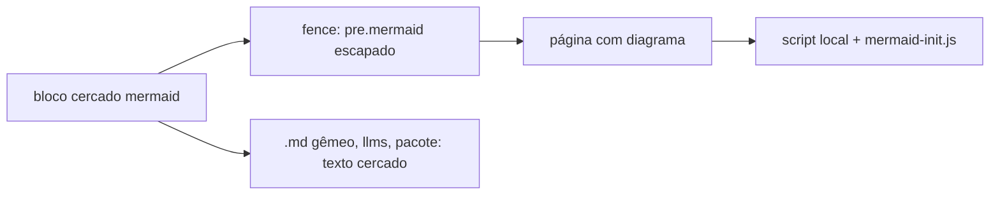

# Portal: renderizar blocos Mermaid (R26)

**Objetivo:** o gerador renderiza bloco cercado `mermaid` como diagrama, com a biblioteca em
`portal/vendor/mermaid/` (sem CDN e sem rede), enquanto `llms.txt`, `llms-full.txt`, os `.md`
gêmeos e `public/pacote/` mantêm o bloco como texto cercado (PE-D17).

**Tier:** 2 (muda `portal/`, risco alto, duas aprovações; ADR 0007: minor).
**Branch:** `feat/2026-11-03-onda-1-mermaid`.

## Impacto Arquitetural

- Compose local será alterado? **N/A.** Site estático.
- Módulo de IaC será criado ou alterado? **N/A.**
- Diagrama ou manifesto de arquitetura será atualizado? **N/A.**
- Integração nova? **Sim, local:** biblioteca Mermaid 12.2.0 fixada em `portal/vendor/mermaid/`
  (MIT), servida do próprio site. Nenhum recurso externo (`R-EXTERNO`).
- **Rollback:** reverter os commits da branch. As páginas voltam a mostrar o bloco `mermaid` como
  código escapado; nenhum dado ou contrato muda.

## Decisões

- Build UMD `mermaid.min.js` (arquivo único; o ESM é dividido em partes). Versão 12.2.0, SHA-256
  `a8a6a6f805b074a8261a2825c86f99c8054acb3b35f50bb7e24a4f9f2c3c3b9f`, registrada em
  `portal/vendor/mermaid/PROCEDENCIA.md`. A 12.3.0 saiu no dia da tarefa e foi preterida.
- A tag `<script>` entra só na página que tem `<pre class="mermaid">`, injetada em `renderizar`
  antes de `</head>`; a inicialização fica em `portal/tema/mermaid-init.js`
  (`startOnLoad: true`, `securityLevel: "strict"`). O template não tem CSP.
- O bloco não leva botão Copiar; o texto-fonte segue no `.md` gêmeo.
- O tema do portal é só claro, então não há variante escura; o Mermaid usa o tema `neutral`.

## Tarefas

- [x] Plano.
- [x] Testes vermelhos em `tests/unidade/test_mermaid.py`.
- [x] `fence` de `mermaid` em `portal/gerador/markdown.py`.
- [x] Script condicional em `portal/gerador/renderizar.py`.
- [x] Biblioteca, licença e `PROCEDENCIA.md` em `portal/vendor/mermaid/`; cópia em `ESTATICOS`.
- [x] `portal/tema/mermaid-init.js` e regra `.mermaid` em `tema.css`.
- [x] Verificação: determinismo, `validar.py`, `gerar.py`, `ruff`, suíte e conferência no navegador.

## Evidência

- Vermelho: 7 dos 9 testes novos falhavam antes da implementação (fence, script, init, sha,
  cópia, css e `.md`); verdes depois, 9 passed.
- Navegador: `guias/metricas-do-programa.html` servida por `http.server`; o diagrama de objetivos e
  KRs desenhou em SVG (15 nós, sem erro de sintaxe), 639 px de largura.
- Determinismo: duas execuções de `gerar.py` com hash idêntico da pasta `public/`.
- Saídas: `.md` e `llms-full.txt` com o bloco cercado; `public/pacote/` sem HTML de diagrama.
