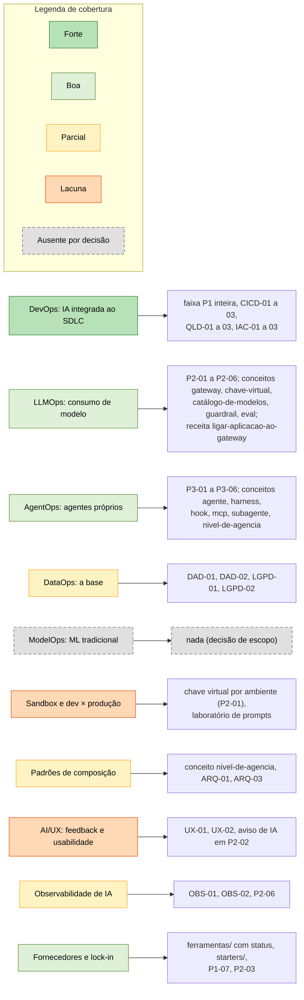
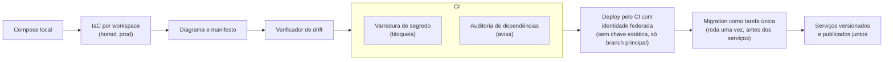
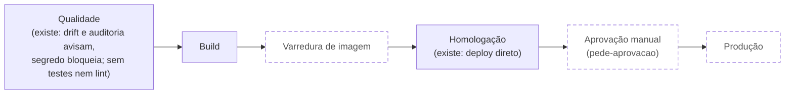

# Engenharia de IA (pesquisa de analista) × catálogo de padrões: contexto e lacunas

**Data:** 2026-10-28 · **Tipo:** nota de pesquisa, insumo da spec
[`2026-10-28-programa-engenharia-de-ia-delta.md`](../specs/2026-10-28-programa-engenharia-de-ia-delta.md).
Não é conteúdo do portal: nada aqui entra em página sem passar pela curadoria.

**Fontes lidas:** o artigo "Without AI Engineering, AI Pilots Stall and Fail to Deliver Value"
(Gartner, ID G00840942, publicado em 2025-09-16, revisado em 2025-12-19, arquivado; há versão
nova de 2026-07-14, "You Can't Scale AI Without AI Engineering") e um resumo em 15 slides gerado
por ferramenta de notebook a partir dele, em português.

---

## 1. Contexto das fontes

### 1.1 O artigo

- Licenciado para uso pessoal de uma pessoa do órgão; o rodapé veda reprodução e uso como insumo
  de treinamento de IA. Pela spec v1.0 §11, entra no portal como referência `tipo: analista`,
  com URL e ID, citação curta e nota de que o conteúdo é licenciado.
- **Tese:** menos da metade dos pilotos de IA chega à produção, em geral por falta de
  operacionalização estruturada e de frameworks de DevOps. A resposta é a **Engenharia de IA**:
  a disciplina que unifica DataOps, ModelOps, LLMOps e AgentOps, com o DevOps integrando a IA ao
  ciclo de vida da aplicação.
- **Figura 1 (fundação da IA composta):** DataOps é a base (pipelines de dados para analytics,
  aplicações, data science e IA); ModelOps cuida do ciclo de vida de ML tradicional; LLMOps, de
  GenAI (LLMs, SLMs, RAG, fine-tuning); AgentOps, de sistemas multiagente (único, cross-platform,
  "internet de agentes"); DevOps, ao lado, integra a IA nas aplicações dentro do SDLC.

  ```mermaid
  flowchart LR
      subgraph PILHA[" "]
          direction TB
          EIA["Engenharia de IA"]
          AO["AgentOps<br/>sistemas multiagente"]
          LO["LLMOps<br/>GenAI: LLMs, SLMs, RAG, fine-tuning"]
          MO["ModelOps<br/>ciclo de vida de ML tradicional"]
          DO["DataOps, a base<br/>pipelines de dados para analytics,<br/>aplicações, data science e IA"]
          EIA --> AO
          EIA --> LO
          EIA --> MO
          AO --> DO
          LO --> DO
          MO --> DO
      end
      DV["DevOps<br/>integra a IA nas aplicações<br/>dentro do SDLC"]
      PILHA -.- DV
      classDef tracejado stroke-dasharray: 6 4
      class DV tracejado
  ```

  *Figura 1 em diagrama: a Engenharia de IA no topo, as três disciplinas de Ops lado a lado sobre a base de DataOps, e o DevOps ao lado (tracejado) integrando tudo ao SDLC.*
- **"Não existe plataforma única."** Engenharia de IA é capacidade e ecossistema de ferramentas
  para sustentar infraestruturas compostas.
- **Figura 2 (evolução):** ModelOps → IA composta → IA generativa → sistemas adaptativos. A
  Engenharia de IA é a ponte entre cada salto: segurança, ética, autonomia, engenharia de decisão,
  gestão de mudança, padrões de design, infraestrutura.

  ```mermaid
  flowchart LR
      MO["ModelOps"] -->|"ponte: Engenharia de IA"| CA["IA composta"]
      CA -->|"ponte: Engenharia de IA"| GA["IA generativa"]
      GA -->|"ponte: Engenharia de IA"| SA["Sistemas adaptativos"]
      PONTE["Engenharia de IA em cada salto:<br/>segurança, ética, autonomia, engenharia de decisão,<br/>gestão de mudança, padrões de design, infraestrutura"]
      PONTE -.- CA
      PONTE -.- GA
      PONTE -.- SA
      classDef nota stroke-dasharray: 6 4
      class PONTE nota
  ```

  *Figura 2 em diagrama: os quatro estágios da evolução e a Engenharia de IA como ponte anotada em cada salto.*
- **Três fases de adoção:**
  1. **Frameworks de desenvolvimento.** Sandbox flexível para experimentar com vários modelos e
     ferramentas. Máxima liberdade dentro da sandbox, com distinção rigorosa entre
     desenvolvimento e deploy. Documentar padrões de design reutilizáveis.
  2. **Fundação de operacionalização.** Arquitetura de Ops para as várias técnicas de IA;
     arquitetura composable; entrega contínua de modelos; diretrizes de AI/UX com feedback humano
     e teste de usabilidade; prática de engenharia de plataforma de IA com mandato executivo.
  3. **Curadoria do ecossistema de fornecedores.** Mapear lacunas da plataforma, estreitar
     fornecedores por critérios, testar em piloto, analisar roadmaps.

  ```mermaid
  flowchart LR
      subgraph F1["Fase 1: frameworks de desenvolvimento"]
          direction TB
          F1a["Sandbox flexível: vários modelos e ferramentas"]
          F1b["Máxima liberdade dentro da sandbox"]
          F1c["Distinção rigorosa entre desenvolvimento e deploy"]
          F1d["Documentar padrões de design reutilizáveis"]
          F1a ~~~ F1b ~~~ F1c ~~~ F1d
      end
      subgraph F2["Fase 2: fundação de operacionalização"]
          direction TB
          F2a["Arquitetura de Ops para as várias técnicas de IA"]
          F2b["Arquitetura composable"]
          F2c["Entrega contínua de modelos"]
          F2d["Diretrizes de AI/UX: feedback humano e teste de usabilidade"]
          F2e["Engenharia de plataforma de IA com mandato executivo"]
          F2a ~~~ F2b ~~~ F2c ~~~ F2d ~~~ F2e
      end
      subgraph F3["Fase 3: curadoria do ecossistema de fornecedores"]
          direction TB
          F3a["Mapear lacunas da plataforma"]
          F3b["Estreitar fornecedores por critérios"]
          F3c["Testar em piloto"]
          F3d["Analisar roadmaps"]
          F3a ~~~ F3b ~~~ F3c ~~~ F3d
      end
      F1 --> F2 --> F3
  ```

  *As três fases de adoção do artigo, com os itens de cada uma; a seta indica a ordem proposta, não um pré-requisito rígido.*

### 1.2 O resumo em slides

Reconta o artigo e **acrescenta material que não está nele**. Nada disso entra no portal sem fonte
primária própria:

- Causa raiz do bloqueio em percentuais (implementação técnica, custo, talento).
- Prazos por fase (1 a 3 meses, 9 ou mais meses, 3 a 9 meses) e "estrutura buy vs. build".
- Observabilidade de IA como "valor de negócio, viés e alucinação em tempo real" e RLHF.
- Matriz de responsabilidade compartilhada por modalidade (SaaS, PaaS, APIs, IaaS, self-hosted).
- Mosaico de componentes (ciclo de vida, arquitetura, privacidade, conformidade, observabilidade,
  design organizacional, literacia, colaboração).
- Roteiro: auditar pilotos travados; isolar a experimentação; quebrar silos.

O deck é fonte secundária gerada por ferramenta e não serve como referência.

---

## 2. O catálogo lido pelas camadas do artigo

O portal organiza as práticas em 12 faixas × 4 momentos do SDLC; o artigo, em camadas de Ops ×
fases de maturidade. São eixos ortogonais.

| Camada ou tema do artigo | O que existe no catálogo | Cobertura |
|---|---|---|
| DevOps: IA integrada ao SDLC | faixa P1 inteira, CICD-01 a 03, QLD-01 a 03, IAC-01 a 03 | Forte. É "DevOps para construir *com* IA"; a entrega contínua *de* modelo e prompt só aparece em P2-05. |
| LLMOps: governar o consumo de modelo | P2-01 a P2-06; conceitos gateway, chave-virtual, catálogo-de-modelos, guardrail, eval; receita ligar-aplicacao-ao-gateway | Boa na governança de consumo. Falta: prompt e configuração como artefato versionado e promovido; RAG; observabilidade de qualidade em produção (só custo). |
| AgentOps: agentes próprios | P3-01 a P3-06; conceitos agente, harness, hook, mcp, subagente, nivel-de-agencia | Boa em segurança e desenho. Falta a operação: desligar, telemetria de trajetória, custo e taxa de sucesso por tarefa; composição multiagente entre donos diferentes. |
| DataOps: a base | DAD-01/02, LGPD-01/02 | Parcial. Só schema e dado pessoal. Nada sobre pipeline, linhagem, dado pronto para RAG, dado sintético, saída publicada imutável. |
| ModelOps: ML tradicional e modelo próprio | nada | Ausente por decisão de escopo ("IA como guia" são agentes e aplicações que consomem modelo). |
| Sandbox e distinção dev × produção | chave virtual por ambiente (P2-01), laboratório de prompts | Lacuna: nenhuma prática diz "experimente livre; nada sobe sem eval, catálogo e aprovação". |
| Padrões de design reutilizáveis (IA composta) | conceito nivel-de-agencia, ARQ-01, ARQ-03 | Parcial: não há catálogo de padrões de composição nem exigência de declará-los na spec. |
| AI/UX: feedback humano e usabilidade | UX-01, UX-02, aviso de IA em P2-02 | Lacuna: estado de incerteza, confiança, canal de feedback na tela de IA. |
| Observabilidade de IA | OBS-01, OBS-02, P2-06 | Parcial: custo e log sim; qualidade, feedback e drift em produção não. |
| Ecossistema de fornecedores e lock-in | `ferramentas/` com status, `starters/`, P1-07, P2-03, nome de catálogo ≠ nome do provedor | Boa no mecanismo, fraca nos critérios publicados. |
| Plataforma de IA com mandato | o próprio portal, o time do gateway, a spec de plataforma | Alinhado. |
| "Menos da metade chega à produção" | `paginas/o-problema.md` usa DORA, Anthropic e OpenAI | Complementar: enquadramento organizacional ao lado do técnico. |



*A tabela de cobertura em diagrama: cada camada do artigo colorida pela cobertura e ligada ao que já existe no catálogo; as duas últimas linhas da tabela (plataforma com mandato e enquadramento executivo) não são camadas e ficam fora.*

### 2.1 Leitura estrutural

1. A espinha não precisa mudar: disciplina × momento é o eixo de quem constrói; a camada de Ops
   é um eixo de leitura e cabe como trilha (ADR 0010).

   ```mermaid
   flowchart LR
       subgraph ESP["Espinha do catálogo: eixo de quem constrói"]
           direction TB
           FX["12 faixas"] --- MM["4 momentos do SDLC"]
       end
       subgraph LEN["Lente de Ops: eixo de leitura do artigo"]
           direction TB
           CAM["Camadas de Ops"] --- FAS["Fases de maturidade"]
       end
       PR["Práticas<br/>(endereço fixo: faixa × momento)"]
       TR["Trilha ou guia<br/>(projeção da lente sobre a espinha, ADR 0010)"]
       ESP --> PR
       PR -->|"selecionadas e ordenadas"| TR
       LEN -.->|"define o recorte"| TR
       ESP -.-|"eixos ortogonais"| LEN
   ```

   *Os dois eixos ortogonais: a espinha endereça as práticas; a lente de Ops define o recorte; a trilha ou guia é a projeção de uma sobre a outra.*
2. O argumento de repetibilidade do artigo é o modelo de força do catálogo. Hoje 1 prática
   bloqueia, 5 avisam e 42 orientam; a regra de ouro ("nada vai para produção sem passar pelo
   framework") só se cumpre com mecanismo.
3. Modelo próprio e ML tradicional: decisão de escopo a registrar em ADR, com a porta de entrada
   pelo catálogo do gateway (P2-03).
4. Status e `ferramentas/` já são a fase 3 do artigo; faltam os critérios.
5. A página "O problema" é o lugar do enquadramento executivo.

---

## 3. O projeto de origem como referência de DevSecOps (lido em 2026-10-28)

O projeto de origem (1.057 commits, 56 specs, 112 planos, 212 arquivos de teste, 40 ADRs) destilou
no `sdd-scaffold` o ciclo compose local → IaC → diagrama e manifesto → drift → segredo no CI. Além
do que o scaffold traz, ele pratica, em ADR e código:



*O ciclo de DevSecOps do projeto de origem, do compose local aos serviços publicados juntos; a lista a seguir detalha o que ele pratica além do scaffold.*

- IaC multiambiente por workspace, configuração por ambiente num só lugar, `apply` em produção só
  pelo pipeline com aprovação manual.
- Deploy sem chave estática: identidade federada do CI para a nuvem, restrita à branch principal.
- Migration roda uma vez, antes do deploy, como tarefa própria; serviços versionados juntos
  (regra promovida da memória após incidente); nada manual fora do CI.
- Operação destrutiva só por workflow rastreável com confirmação digitada.
- Configuração insegura aborta o boot em produção; máscara de segredo no log; token guardado só
  como hash.
- Rota nasce protegida: auth e rate limit no roteador, teste que quebra se uma rota dispensar
  credencial, resposta única para toda falha de credencial, proteção contra SSRF em destino de
  webhook, documentação interna não pública.
- Telemetria OpenTelemetry desde o compose local (perfil), collector como sidecar, correlação
  log ↔ trace, limiares de alerta declarados em ADR.
- Orçamento de performance como teste (memória por componente contra limite); trabalho de modelo
  nunca dentro do request HTTP (fila, 202, polling); lote × custo unitário abaixo do timeout.
- Padrões de IA composta: cascata determinístico → modelo com limiar de confiança → revisão humana
  posterior → padrão seguro; o modelo nunca bloqueia o pipeline; cache de decisão; contrato,
  guardrail e anti-injeção selados em código, contexto governável no banco com RBAC e histórico;
  saída publicada imutável e versionada com checksum; dado bruto arquivado com rastreabilidade por
  linha.

  ```mermaid
  flowchart LR
      DET["Etapa determinística"] --> NORM["Normalização"]
      NORM --> MOD["Modelo com<br/>limiar de confiança"]
      MOD -->|"canal A: acima do limiar"| APL["Aplica a decisão"]
      MOD -->|"canal B: abaixo do limiar"| SUG["Sugere"]
      SUG --> SEG["Padrão seguro"]
      MOD -.->|"falha ou timeout:<br/>nunca bloqueia o pipeline"| SEG
      APL --> FILA["Fila de revisão<br/>humana posterior"]
      SUG --> FILA
      FILA -->|"decisão confirmada"| CACHE["Cache de decisão"]
      CACHE -.->|"realimenta"| DET
  ```

  *A cascata de IA composta: o determinístico resolve primeiro; o modelo aplica (canal A) ou só sugere (canal B) conforme o limiar; o padrão seguro cobre a falha; a revisão humana vem depois e realimenta o cache de decisão.*

  ```mermaid
  flowchart LR
      subgraph COD["Selado em código"]
          direction TB
          C1["Contrato"]
          C2["Guardrail"]
          C3["Anti-injeção"]
      end
      subgraph BD["Governável no banco"]
          direction TB
          B1["Contexto"]
          B2["RBAC"]
          B3["Histórico"]
      end
      COD ---|"×"| BD
  ```

  *A separação entre o que é selado em código e o que é governável no banco, com RBAC e histórico.*

**O que ele decidiu e não fez.** O ADR de CI/CD desenhou `qualidade → build → varredura de imagem →
homologação → aprovação manual → produção`. O que existe é um workflow de qualidade (drift
informativo, varredura de segredo, auditoria de dependências informativa) e deploy direto em
homologação. Nenhum workflow roda a suíte de testes nem o lint; não há varredura de imagem; não há
estágio de produção com aprovação. A validação ficou "local rígida" por steering, ou seja, por
obediência do agente. É o piloto que não atravessa a ponte dentro do próprio projeto que serviu de
modelo, e a prova de que `orienta` não basta.



*O pipeline desenhado no ADR de CI/CD: os nós tracejados são os estágios decididos e não implantados.*

---

## 4. Lacunas que viram trabalho

Resumidas na spec do programa. Em ordem de valor ÷ custo: sandbox e promoção; pipeline como
`bloqueia`; promoção entre ambientes por IaC; identidade federada no deploy; operação destrutiva
por workflow; fail-closed na configuração; rota protegida por omissão; telemetria OTel desde o
local; orçamento de performance; trabalho de modelo fora do request; observabilidade de IA;
operação do agente; prompt como artefato; padrões de composição; trilha de produto (PRD e
Operar); sistemas compostos entre departamentos; dados prontos para IA; critérios de fornecedor.
