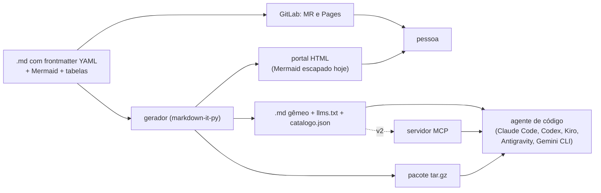

# Formato dos documentos do programa: visual para pessoas, legível para agentes

**Data:** 2026-10-28 · **Tipo:** nota de pesquisa, insumo da spec
[`2026-10-28-programa-engenharia-de-ia-delta.md`](../specs/2026-10-28-programa-engenharia-de-ia-delta.md).
Não é conteúdo do portal. Responde: (a) formato Markdown para specs, planos, notas e metas, visual
e legível por agente; (b) o que é o Open Knowledge Format (OKF) e se vale adotar; (c) OKR, em segundo plano.

## 1. O que foi verificado no repositório e nos harnesses

- **Gerador.** `portal/gerador/markdown.py` cria `MarkdownIt("commonmark", {"html": False}).enable("table")`
  e só tem regra própria de `fence` para o bloco `prompt`. Rodado no `.venv`, um bloco `` ```mermaid ``
  sai como `<div class="bloco"><pre><code class="language-mermaid">flowchart LR…</code></pre></div>`
  com botão Copiar: **o Mermaid é escapado e mostrado como código, não renderizado**. `<svg>` inline
  vira texto; só `` sobrevive como imagem. Não há script Mermaid em `portal/tema/` nem
  em `portal/templates/`. A spec v1.0 §7.1 exige HTML bruto desligado e §7.3 diz que o `.md` gêmeo
  traz "diagramas descritos em texto", o que combina com diagrama em texto na fonte.
- **Convenção visual atual.** Os mockups em `docs/specs/*-mockups/` são HTML/CSS inline (caixas e
  setas em `class="mapa"`; um único `<svg>` em `trilha-v3.html`), feitos para aprovação de desenho,
  não para o site. O repositório já usa Mermaid como fonte em `exemplos/ARQ-04/c4-*.mmd`, conferido
  por `verificar-c4.py` contra `mapa.yml`; a Arquitetura Viva (`skills/arquitetura-viva/SKILL.md`)
  mantém `Arquitetura/arquitetura.drawio`, e `mapa.yml` liga os dois por `drawio_label`.
- **Harnesses.** Pela nota `2026-10-06-mecanismos-hooks-por-harness.md`: todos leem Markdown e
  frontmatter YAML; limites só valem para instruções sempre carregadas (Codex 32 KiB, Antigravity
  24 KB/arquivo e 20 k tokens, recomendação de 200 linhas no Claude Code); skills `<500` linhas.
  Documento em `docs/` é lido sob demanda, então o limite prático é o orçamento de contexto, e
  imagem PNG ou XML drawio consome muito mais tokens que o mesmo diagrama em texto.
- **GitLab e GitHub.** GitLab: "GitLab supports Mermaid version 11", bloco `mermaid`; PlantUML e
  Kroki exigem administrador no self-managed (https://docs.gitlab.com/user/markdown/#mermaid).
  GitHub: "add Mermaid syntax inside a fenced code block with the `mermaid` language identifier";
  além de Mermaid só GeoJSON, TopoJSON e STL, sem PlantUML nem D2
  (https://docs.github.com/en/get-started/writing-on-github/working-with-advanced-formatting/creating-diagrams).
- **OKR no repositório.** `grep -i okr` em `docs/` e `esquemas/` não acha nada; "métrica" e
  "indicador" só em prosa (delta, Onda 0 "enquadrar e medir"; `espinha.yml`). Não há schema de meta.

## 2. Tabela comparativa

| Formato | Legível por agente | GitLab | GitHub | Portal hoje | Custo de manutenção | Fonte |
|---|---|---|---|---|---|---|
| Mermaid em bloco cercado | sim, texto curto | sim, nativo v11 | sim, nativo | não: escapado como código | baixo; diff legível | docs GitLab/GitHub acima; `markdown.py` |
| PlantUML | sim | só com admin (self-managed) | não | não | baixo; exige servidor | docs GitLab |
| D2 | sim | não | não | não | baixo; CLI extra no CI | docs GitHub (ausente) |
| ASCII | sim, mas ambíguo | como código | como código | como código | alto: realinhar à mão | — |
| drawio (XML) | ruim: XML longo | não como bloco | não | não | médio; editor próprio | `skills/arquitetura-viva` |
| PNG/SVG exportado | não (ou visão, caro) | sim | sim | sim via `` | alto: refazer a cada mudança | `markdown.py` |
| OKF (bundle de `.md` + YAML) | sim | sim, é Markdown | sim | parcial: só com schema por tipo | Tier 2 para ingerir; v0.2 | SPEC.md (§4) |
| **Markdown + frontmatter YAML + Mermaid** | **sim** | **sim** | **sim** | frontmatter sim; Mermaid não (§6) | **baixo** | spec v1.0 §6 |

## 3. Recomendação de formato

Um `.md` por spec, plano, nota ou meta: **frontmatter YAML** (o que validador e agente leem: `id`,
`titulo`, `tipo`, `status`, `onda`, `dono`, `revisado_em`, `relacionados`); **prosa curta** por seção;
**um Mermaid em bloco cercado por decisão ou fluxo** (`flowchart`, `sequenceDiagram`, `C4Context`,
`gantt` para ondas); **tabelas** para dados. Regras: drawio só em `Arquitetura/arquitetura.drawio`
da Arquitetura Viva (decisão tomada, verificada por mecanismo); PNG nunca como fonte, só exportação;
nenhum `<svg>` ou HTML inline, porque o gerador escapa. Tier 0 em `docs/`; já funciona em todo lugar.

## 4. Open Knowledge Format (OKF)

**O que é.** Especificação aberta publicada pelo Google Cloud em 2026-06-12 (blog "How the Open
Knowledge Format can improve data sharing"), que formaliza o padrão "LLM wiki": conhecimento como
"a directory of markdown files with YAML frontmatter". v0.1 no lançamento; a `SPEC.md` canônica está
em v0.2 e diz ser "a starting point, not a finished standard". Repositório canônico
https://github.com/GoogleCloudPlatform/open-knowledge-format (Apache-2.0, ~1,2 k estrelas; a cópia
em `knowledge-catalog/okf/` está congelada). Inclui agente de referência que gera bundles a partir
do BigQuery e visualizador HTML estático; **não há JSON Schema nem validador**, só conformidade em
prosa (§11); não menciona diagramas nem imagens. **Homônimo:** a sigla OKF também designa a Open Knowledge Foundation
(https://okfn.org), que mantém Data Package e Frictionless Data e **não** define um "Open Knowledge
Format"; o dono quer o primeiro, o formato de conhecimento para agentes.

**Modelo (SPEC v0.2).** Bundle = árvore de `.md`, distribuída como repositório git, tarball ou
subpasta. `index.md` (navegação, com `okf_version`) e `log.md` (histórico) são reservados e
opcionais; todo outro `.md` é um conceito, cujo **ID é o caminho sem `.md`**. Frontmatter: `type`
obrigatório; `title`, `description`, `resource`, `tags` recomendados; `generated: {by, at}`,
`verified: [{by, at}]`, `sources: [{resource, id, title, last_modified}]`, `status`
(draft|stable|deprecated), `stale_after` opcionais; chaves desconhecidas devem ser toleradas.
Ligações são **links Markdown comuns** (`/caminho.md` relativo ao bundle, recomendado, ou `./x.md`),
e o conjunto forma o grafo. Exemplo mínimo:

```markdown
---
type: Spec
title: Programa Engenharia de IA, delta
status: draft
generated: {by: equipe-do-programa, at: 2026-10-28T12:00:00-03:00}
verified: [{by: dono-do-programa, at: 2026-10-28T15:00:00-03:00}]
stale_after: 2027-04-28T00:00:00-03:00
sources: [{resource: https://cloud.google.com/blog/..., id: okf-blog}]
---
Depende de [/docs/research/2026-10-28-formato-visual-e-agentes.md](...). Fonte [^okf-blog].
```

**Recomendação: adaptar, não adotar.** O repositório já cumpre o núcleo do OKF (Markdown +
frontmatter, ID pelo caminho, links Markdown, `llms.txt` e pacote como distribuição), com validação
mais forte (JSON Schema por tipo, `[ref:id]` conferido). Adotar o bundle como formato-fonte trocaria
isso por um padrão v0.2 sem validador e sem tipos fixos, Tier 2 em `esquemas/`, `scripts/` e
`portal/`. O que vale levar, Tier 0 em `docs/`: `type` e `status` no frontmatter dos documentos do
programa, `verified`/`stale_after` como equivalentes de `revisado_em`/`revisar_ate`, e `sources`
com `id` para nota de rodapé por afirmação. Opcional, Tier 2 e só se um consumidor pedir: emitir um
bundle OKF como mais uma saída do gerador ao lado de `llms.txt` (§7.3 da spec), mapeando os campos.

## 5. OKR, em segundo plano

| Opção | Onde vive | Tier | Prós e contras |
|---|---|---|---|
| (i) seção `## OKR` com tabela por objetivo | no próprio `.md` da spec ou plano | 0 (`docs/`) | zero custo; sem validação; progresso por onda editado à mão |
| (ii) `docs/okr/<ano>-<nome>.yml` + `esquemas/okr.schema.json` no `validar.py`, página no gerador | YAML como fonte | 2 (`esquemas/`, `scripts/`, `portal/`, duas aprovações) | validado e consultável; adia o uso até o Tier 2 |
| (iii) YAML como fonte, tabela gerada no `.md` | os dois | 2, mas faseável: começa como (i) com bloco YAML cercado | o agente lê o YAML, a pessoa vê a tabela |

Recomendação: **(iii) em fases**. Hoje, bloco `` ```yaml `` dentro da seção `## OKR` do delta (Tier 0),
com o schema abaixo; quando a Onda 0 medir de verdade, mover para `docs/okr/` com schema e página.

```yaml
objetivo: Reduzir o tempo do PRD à produção com harness corporativo
dono: lideranca-do-programa          # papel, nunca pessoa
kr:
  - id: KR-01
    metrica: lead time PRD -> deploy
    unidade: dias
    onde_medida: pipeline do GitLab (merge -> deploy)
    linha_de_base: {valor: 45, data: 2026-10-01}
    meta_por_onda: {onda-1: 30, onda-2: 20, onda-3: 10}
```

## 6. O que muda no gerador, e o que não muda

Se o portal passar a renderizar Mermaid: regra de `fence` em `markdown.py` emitindo
`<pre class="mermaid">` para `info == "mermaid"` mais o script Mermaid em `portal/vendor/` (sem CDN,
spec §7.2); Tier 2 em `portal/`, com teste em `tests/unidade/`. Não muda: os agentes já leem o `.md`
direto pelo `llms.txt`, pelo `llms-full.txt` e pelo pacote `tar.gz`, e o Mermaid em texto já é legível.



## Fontes consultadas

Spec v1.0 §6 e §7; `portal/gerador/markdown.py`; `docs/research/2026-10-06-*.md`; docs GitLab e
GitHub (§1); blog do Google Cloud de 2026-06-12 e `SPEC.md` v0.2 em
https://github.com/GoogleCloudPlatform/open-knowledge-format; https://okfn.org (homônimo);
https://www.domo.com/glossary/open-knowledge-format (terciária; data o OKF de 2024, contradiz a primária).
