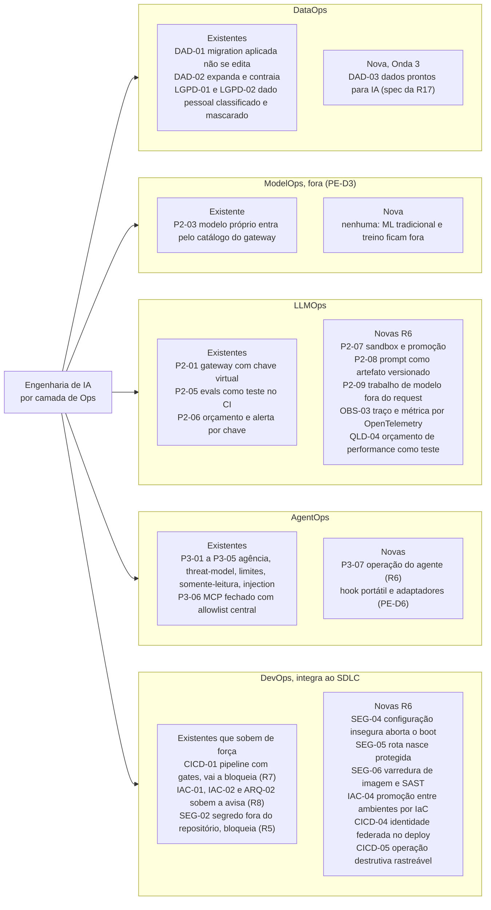
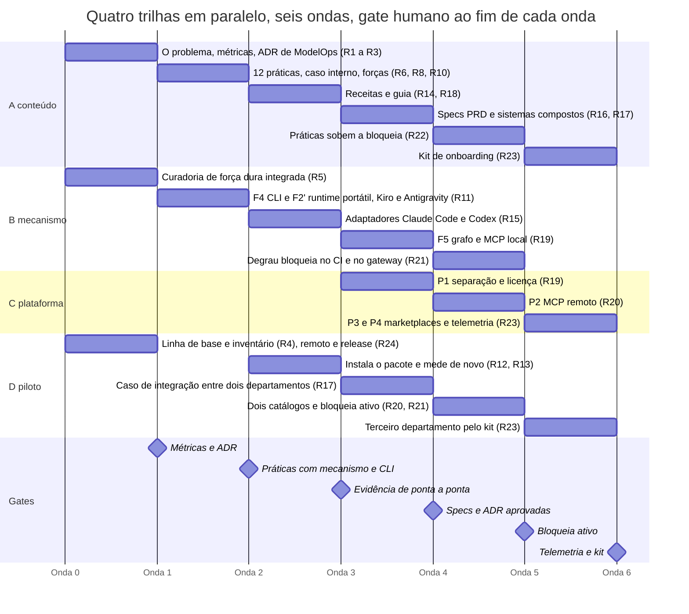
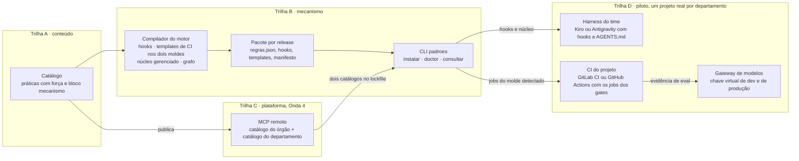
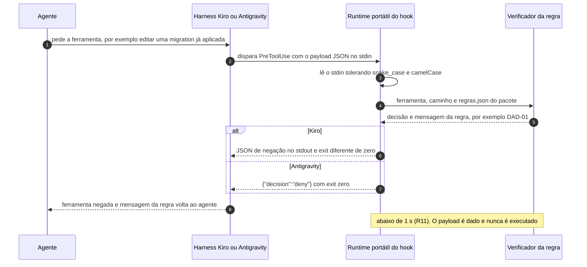
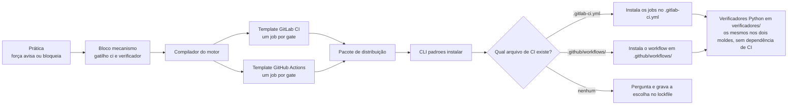
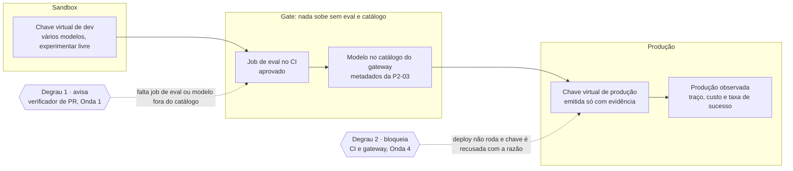

# Spec delta: programa Engenharia de IA de ponta a ponta (do PRD à produção, harness corporativo e base única)

> **Tier:** 2 (programa com várias entregas; toca `esquemas/` na Onda 3, `skills/`, `portal/`
> e o CI dos projetos; `esquemas/`, `portal/`, `scripts/` e `skills/` são risco alto).
> **Status:** aprovada
> **Aprovado por:** thiago
> **Aprovado em:** 2026-10-28
> **Data:** 2026-10-28
> **Altera:** a spec v1.0 do portal
> ([`2026-10-01-portal-padroes-engenharia-design.md`](2026-10-01-portal-padroes-engenharia-design.md))
> em §2 (público), §19 (fora de escopo) e §20 (roteiro); a spec do motor
> ([`2026-10-06-motor-harness-cli-design.md`](2026-10-06-motor-harness-cli-design.md)) em §17
> (ordem das fases F2 e F3); e a spec de plataforma
> ([`2026-10-06-plataforma-padroes-produto-design.md`](2026-10-06-plataforma-padroes-produto-design.md))
> em §16 (a P1 começa depois do piloto). O que este delta não menciona continua como está.
> **Origem:** brainstorming com o dono em 2026-10-28; a nota de pesquisa
> [`2026-10-28-engenharia-de-ia-analista-e-catalogo.md`](../research/2026-10-28-engenharia-de-ia-analista-e-catalogo.md)
> (artigo de analista sobre Engenharia de IA, resumo em slides e leitura do projeto de origem).

## Motivação

O portal publica 48 práticas de como construir *com* agente, e o motor de harness já compila
força em mecanismo (1 prática bloqueia, 5 avisam, 42 orientam). O dono quer mais do que isso:

1. **Entregar software de alta qualidade do PRD à produção, com agentes de ponta a ponta**, para
   engenheiros, arquitetos, PMs e builders.
2. **Reduzir lixo e protótipos que não chegam à produção**, e aumentar a produtividade.
3. **Integrar sistemas de IA compostos** de vários departamentos com um objetivo comum.
4. **Levar as práticas para os agentes:** um harness corporativo integrado e uma base de
   conhecimento única.

A pesquisa de analista lida na origem diz que menos da metade dos pilotos de IA chega à produção
por falta de operacionalização, e propõe a Engenharia de IA (DataOps, ModelOps, LLMOps, AgentOps,
com o DevOps integrando ao SDLC) em três fases: sandbox com separação rígida entre desenvolvimento
e produção, fundação de operacionalização e curadoria de fornecedores. O catálogo cobre bem o
DevOps de construir com agente e a governança de consumo de modelo, e não cobre: a promoção da
sandbox à produção, a operação do agente, a observabilidade de qualidade, o PRD e a operação como
etapas, e a integração entre sistemas de departamentos diferentes.

*Figura 1. As cinco camadas da Engenharia de IA do analista, com as práticas que o catálogo já tem
em cada uma e as que a R6 e a Onda 3 acrescentam; ModelOps fica fora (PE-D3), e o DevOps é a camada
que mais ganha, porque é onde o gate se instala.*

O projeto de origem, lido como referência de DevSecOps, confirma o diagnóstico de dentro: o ADR de
CI/CD dele desenhou varredura de imagem, suíte no pipeline e aprovação manual para produção, e
nenhum dos três foi implantado; a validação ficou por obediência do agente ao steering. É a prova
de que `orienta` não basta, e de que o harness precisa instalar o gate.

## Objetivos e resultados-chave (OKR)

Os quatro objetivos são os da Motivação, nas palavras do dono. Cada um tem resultados-chave (KR)
com métrica, unidade, onde é medida, linha de base na Onda 0 e meta por onda. Toda coleta é manual,
pelos times piloto, na tabela do Checkpoint do plano de cada onda (PE-D14); as métricas são
publicadas no portal pela R3, medidas de novo pela R13 (Onda 2) e pela R22 (Onda 4). Para os KRs de
tempo e de lixo (KR1.1 a KR1.3, KR2.2 e KR2.3) esta spec fixa a direção; o número é fixado pelo
dono no Checkpoint da Onda 0, a partir da linha de base, porque fixar antes seria inventar. Os
agregados saem sem nome de órgão, departamento, sistema ou pessoa (PE-D10).

### O1. Entregar software de alta qualidade do PRD à produção, com agentes de ponta a ponta

| KR | Métrica | Unidade | Onde é medida | Linha de base (Onda 0) | Meta por onda |
|---|---|---|---|---|---|
| KR1.1 | Tempo do PRD aprovado ao primeiro deploy em produção | dias corridos, mediana por projeto | data de aprovação do PRD ou da spec e data do primeiro deploy, na tabela do Checkpoint | só onde o piloto já registra a data de aprovação; onde não registra, a série começa na Onda 3 com a etapa Descobrir (R16, PE-D14) | Onda 2: segunda medição (R13) · Onda 3: série aberta nos dois pilotos · Onda 4: abaixo da linha de base nos dois pilotos (R22) |
| KR1.2 | Frequência de deploy e lead time do commit ao deploy em produção | deploys por semana; horas, mediana | histórico de jobs de deploy do pipeline e git log do piloto, transcritos para a tabela | medida na Onda 0 nos dois pilotos (R4) | Onda 2: frequência não cai e lead time não sobe com os gates instalados (R12, R13) · Onda 4: frequência maior e lead time menor que a linha de base |
| KR1.3 | Taxa de falha de mudança e tempo de restauração | % dos deploys com rollback ou hotfix; horas | registro de incidentes e de rollbacks do piloto (IAC-03, OBS-02), na tabela | medida na Onda 0 | Onda 2: não piora · Onda 4: abaixo da linha de base |

### O2. Reduzir lixo e protótipos que não chegam à produção, e aumentar a produtividade

| KR | Métrica | Unidade | Onde é medida | Linha de base (Onda 0) | Meta por onda |
|---|---|---|---|---|---|
| KR2.1 | Pilotos de IA promovidos ou encerrados por critério declarado, nunca abandonados | % do inventário com decisão (promover, encerrar ou manter) e data | inventário de pilotos por departamento, no Checkpoint (R4) | o percentual encontrado no inventário da Onda 0 | Onda 2: 100 % do inventário com decisão e data · Onda 3: todo piloto novo nasce com critério de promover ou encerrar com data no PRD (R16) · Ondas 4 e 5: nenhum piloto abandonado |
| KR2.2 | MRs abandonadas por mês | MRs fechadas sem merge por mês, por projeto | lista de MRs do piloto no GitLab ou no GitHub, transcrita para a tabela | últimos três meses antes da Onda 0 | Onda 2: não sobe · Onda 4: abaixo da linha de base |
| KR2.3 | Código removido por mês | linhas removidas por mês, por projeto | git log do piloto | últimos três meses antes da Onda 0 | Onda 2: registrada e comparada (R13) · Onda 4: abaixo da linha de base sem queda da frequência de deploy (KR1.2) |

### O3. Integrar sistemas de IA compostos de vários departamentos com um objetivo comum

| KR | Métrica | Unidade | Onde é medida | Linha de base (Onda 0) | Meta por onda |
|---|---|---|---|---|---|
| KR3.1 | Sistemas de IA com contrato versionado (OpenAPI ou MCP) no registro compartilhado | sistemas, contagem | registro compartilhado da spec da R17 (a allowlist da P3-06 que vira registro) | 0: não há registro | Onda 3: ≥ 2, um por departamento piloto (R17) · Onda 4: os dois resolvidos pelo lockfile dos projetos · Onda 5: ≥ 3, com o terceiro departamento (R23) |
| KR3.2 | Integrações entre departamentos com eval de integração verde e traço correlacionado | integrações, contagem | caso interno sanitizado da R17 e o job de eval no CI dos dois projetos | 0 | Onda 3: 1, o caso dos dois departamentos (R17) · Ondas 4 e 5: eval verde a cada release dos dois sistemas |

### O4. Levar as práticas para os agentes: harness corporativo integrado e base de conhecimento única

| KR | Métrica | Unidade | Onde é medida | Linha de base (Onda 0) | Meta por onda |
|---|---|---|---|---|---|
| KR4.1 | Práticas instaladas por força em cada projeto piloto | práticas por força (`bloqueia`, `pede-aprovacao`, `avisa`, `orienta`), por projeto | `regras.json` do pacote instalado e saída do `padroes doctor` | 0 instaladas (pacote não existe no piloto); no catálogo, 1 `bloqueia`, 5 `avisa` e 42 `orienta` antes da R5 | Onda 0, no catálogo: ≥ 13 acima de `orienta` (R5) · Onda 2: nos dois pilotos, todas as práticas da Onda 1 em `avisa` ou acima, ≥ 20 acima de `orienta` e ≥ 3 em `bloqueia` (DAD-01, SEG-02, CICD-01) (R12) · Onda 4: toda prática da Onda 1 com template de job ou verificador em `bloqueia` (R22) |
| KR4.2 | Projetos que consultam o catálogo pelo MCP | projetos, contagem; catálogos por lockfile | lockfile dos projetos (`--catalogo`) e relato do time no Checkpoint; telemetria com opt-in (P4) só na Onda 5 | 0 | Onda 3: 2, os dois pilotos pelo MCP local (R19) · Onda 4: ≥ 1 projeto com dois catálogos (R20) · Onda 5: 3, com o terceiro departamento (R23) |
| KR4.3 | Projetos com `padroes doctor` sem divergência | projetos, contagem | saída do `doctor` colada no Checkpoint | 0 | Onda 1: 1, o monorepo em dogfooding (R11) · Onda 2: 2, os pilotos (R12) · Onda 5: 3 (R23) |

```mermaid
flowchart TB
    O1["O1 · Entregar software de alta qualidade<br/>do PRD à produção, com agentes de ponta a ponta"]
    O2["O2 · Reduzir lixo e protótipos que não chegam<br/>à produção, e aumentar a produtividade"]
    O3["O3 · Integrar sistemas de IA compostos<br/>de vários departamentos com um objetivo comum"]
    O4["O4 · Levar as práticas para os agentes:<br/>harness corporativo integrado e base única"]
    O1 --> KR11["KR1.1 tempo do PRD aprovado<br/>ao primeiro deploy em produção"]
    O1 --> KR12["KR1.2 frequência de deploy e lead time"]
    O1 --> KR13["KR1.3 taxa de falha e tempo de restauração"]
    O2 --> KR21["KR2.1 pilotos promovidos ou encerrados<br/>por critério declarado, nunca abandonados"]
    O2 --> KR22["KR2.2 MRs abandonadas por mês"]
    O2 --> KR23["KR2.3 código removido por mês"]
    O3 --> KR31["KR3.1 sistemas de IA com contrato versionado<br/>no registro compartilhado"]
    O3 --> KR32["KR3.2 integrações entre departamentos<br/>com eval de integração e traço correlacionado"]
    O4 --> KR41["KR4.1 práticas instaladas por força<br/>em cada projeto piloto"]
    O4 --> KR42["KR4.2 projetos que consultam o catálogo pelo MCP"]
    O4 --> KR43["KR4.3 projetos com doctor sem divergência<br/>e catálogos resolvidos pelo lockfile"]
```

*Figura 2. Os quatro objetivos do dono e os resultados-chave que os medem; a linha de base e as
metas estão nas tabelas acima, e a coleta é manual (PE-D14).*

## Decisões

| ID | Decisão |
|---|---|
| PE-D1 | **Objetivos medidos por OKR.** Os quatro objetivos da Motivação (O1 a O4) têm resultados-chave na seção "Objetivos e resultados-chave (OKR)", cada um com métrica, unidade, onde é medida, linha de base na Onda 0 e meta por onda. As métricas são: tempo do PRD aprovado ao primeiro deploy em produção; frequência de deploy, lead time, taxa de falha e tempo de restauração; percentual de pilotos promovidos ou encerrados por critério declarado (nunca abandonados); MRs abandonadas e código removido por mês; sistemas de IA com contrato versionado no registro compartilhado e integrações com eval verde; práticas instaladas por força; projetos que consultam o catálogo pelo MCP e com `doctor` sem divergência. Nenhuma onda fecha sem a medição dos KRs que ela cobre; a coleta é manual (PE-D14), e a meta numérica dos KRs de tempo e de lixo é fixada pelo dono no Checkpoint da Onda 0, a partir da linha de base. |
| PE-D2 | **Público ampliado.** PM e arquiteto entram no público primário da spec v1.0 §2, ao lado de quem constrói. O portal continua sendo para quem constrói, com PM e arquiteto dentro do fluxo; não vira guia executivo. |
| PE-D3 | **ML tradicional e treino de modelo ficam fora.** Modelo próprio, de qualquer departamento, entra pelo catálogo do gateway com os metadados da P2-03 (operador, retenção, system card, vedação de treinamento). Registrado em ADR e em §19 da spec v1.0. |
| PE-D4 | **A espinha não muda neste delta.** A leitura por camada de Ops entra como trilha (tipo criado pela ADR 0010). As etapas Descobrir (PRD) e Operar, e a spec de sistemas compostos, são entregas da Onda 3, cada uma com spec Tier 2 própria. |
| PE-D5 | **Dois moldes de CI, GitLab como principal.** A prática diz o gate, não a ferramenta. O motor entrega dois templates de job por gate (GitLab CI e GitHub Actions); o CLI detecta o CI pelo arquivo presente no repositório e instala o molde certo; a seção `### Por ferramenta` do exemplo traz os dois, GitLab primeiro. Os verificadores continuam scripts Python sem dependência de CI. |
| PE-D6 | **Adaptadores na ordem dos pilotos: Kiro e Antigravity primeiro.** A F2 do motor passa a entregar o runtime portátil e os adaptadores de Kiro e Antigravity; Claude Code e Codex vêm na Onda 2. O hook portátil bloqueia emitindo JSON de negação e saindo com código diferente de zero (Kiro) ou `{"decision":"deny"}` com saída zero (Antigravity). No Kiro o bloqueio versionável é só por hook em `.kiro/hooks/`; no Antigravity o núcleo gerenciado respeita 24 KB por arquivo e o orçamento de 20 mil tokens das regras sempre ativas, e a leitura da memória vai pelo `AGENTS.md`, porque não há hook de início de sessão. |
| PE-D7 | **CICD-01 vira `bloqueia` antes do piloto.** Lint, suíte e verificador de PR no CI, instalados pelo harness, para o piloto não repetir o projeto de origem. Sem mudança de schema: `bloqueia` é a força do schema, e a `R-GATILHO` (gatilho de harness e de Git ou CI) é satisfeita com o gatilho `ao-parar` rodando a validação local (a QLD-03 diz que o que o CI roda, roda antes do push), o hook `pre-push` e o job de CI. Bloquear o merge sem pipeline verde é configuração do projeto no GitLab ou no GitHub, documentada na receita e conferida pelo `doctor`; o CLI não chama a API do servidor neste programa. |
| PE-D8 | **Gate "nada sobe sem eval e catálogo" em dois degraus.** Primeiro `avisa` no verificador de PR (projeto que chama modelo precisa de job de eval e de nome de modelo do catálogo); depois `bloqueia` no CI e no gateway (chave virtual de produção só com evidência). O segundo degrau depende do time do gateway e fica na Onda 4. |
| PE-D9 | **Fonte de analista:** referência `tipo: analista`, URL e ID, citação curta, nota de licença, verificada contra a versão de 2026-07 do documento. O resumo em slides não é fonte: o que só está nele fica fora ou ganha fonte primária própria. |
| PE-D10 | **Piloto em dois departamentos, um projeto real cada, modelo agnóstico.** Nome de órgão, departamento, sistema e pessoa ficam fora dos artefatos. O caso de integração entre os dois sai como caso interno sanitizado. |
| PE-D11 | **Quatro trilhas paralelas e seis ondas com gate humano:** conteúdo (A), mecanismo (B), plataforma (C) e piloto (D). Nada de uma onda posterior começa sem o gate da anterior. A P1 da spec de plataforma passa a começar depois da Onda 2. |
| PE-D12 | **O projeto de origem vira caso interno sanitizado** ("classificação híbrida governada") com os padrões de IA composta que ele pratica, e as práticas novas de DevSecOps citam os ADRs dele como evidência interna, sem nome de sistema. |
| PE-D13 | **Verificadores novos nascem em `verificadores/` do monorepo**, como a rodada de força dura já fez (branch `feat/2026-10-08-curadoria-forca-dura`: sete verificadores internos). O `sdd-scaffold` não é alterado; os dois verificadores dele já vendidos em `mecanismos/sdd-scaffold/` continuam como estão. |
| PE-D14 | **Medição manual na linha de base.** As métricas da PE-D1 são coletadas pelos times piloto com um modelo de tabela no plano da Onda 0; não há script de coleta neste programa. "Tempo do PRD à produção" só ganha linha de base onde o projeto piloto já registra a data de aprovação do PRD ou da spec; onde não registra, a série começa na Onda 3. A medição não bloqueia R1, R2, R3 e R5. |
| PE-D15 | **Fonte licenciada é verificada por pessoa.** O artigo de analista e a versão de 2026-07 são lidos e conferidos pelo dono, que registra a verificação manual na nota da referência, como a skill já prevê para fonte que bloqueia robô. Nenhum agente processa o documento. |
| PE-D16 | **Sanitização é manual, pela ADR 0011.** A lista de termos sensíveis fica fora do repositório e a varredura roda antes de cada commit que publica dado de piloto ou do projeto de origem (R4, R10, R13, R17). Cada plano traz esse passo no Checkpoint. |
| PE-D17 | **Visual para pessoas, legível para agentes: um só arquivo Markdown.** Todo documento do programa (spec, plano, nota, caso, receita) é `.md` com frontmatter YAML, prosa curta, um diagrama Mermaid em bloco cercado por decisão ou fluxo, e tabela para dados. Mermaid é texto: renderiza no GitLab e no GitHub e é lido por agente pelo `llms.txt` e pelo pacote. Drawio fica só na Arquitetura Viva; PNG nunca é fonte. O Open Knowledge Format (spec do Google Cloud, v0.2, 2026-06) é **adaptado, não adotado**: o repositório já cumpre o núcleo dele (Markdown com frontmatter, ID pelo caminho, links, `llms.txt`); entram no frontmatter dos documentos do programa só os campos `type`, `status`, `verified`, `stale_after` e `sources`. Base: nota [`2026-10-28-formato-visual-e-agentes.md`](../research/2026-10-28-formato-visual-e-agentes.md). O portal hoje escapa Mermaid como código; renderizar é a R26. |

## Requisitos

Cada requisito traz ao menos um critério de aceite. Os requisitos estão agrupados por onda; a
onda é a fase do plano.

### Onda 0: enquadrar e medir

**R1** A página "O problema" ganha o elo "piloto que não chega à produção" e o número "menos da
metade", com referência `analista` e nota de licença.
- Critério: Dado o portal gerado, quando abro "O problema", então vejo o elo e o número com
  `[ref:<id>]` apontando para uma referência `tipo: analista` com `verificacao: V`, nota de
  licença e nota de verificação manual pelo dono (PE-D15); `validar.py` e `gerar.py` saem com 0.

**R2** Uma ADR registra o escopo de ModelOps: ML tradicional e treino fora; modelo próprio entra
pelo catálogo do gateway com os metadados da P2-03.
- Critério: Dado `docs/adr/`, quando listo as ADRs, então existe uma com status `aceita` que diz
  isso, e §19 da spec v1.0 cita a ADR.

**R3** As métricas da PE-D1 estão publicadas numa página ou seção do portal, cada uma com
definição, unidade e onde é medida.
- Critério: Dado o portal gerado, quando abro a página das métricas, então cada métrica tem os
  três campos, e o texto diz que a linha de base é medida nos projetos piloto.

**R4** A linha de base das métricas está registrada para os dois projetos piloto, junto com o
inventário dos pilotos de IA existentes em cada departamento (promover, encerrar ou manter, com
data).
- Critério: Dado `docs/plans/<plano da onda 0>.md`, quando leio o Checkpoint, então há a tabela de
  linha de base por projeto, preenchida pelos times piloto (PE-D14), e o inventário, sem nome de
  órgão, departamento, sistema ou pessoa.

**R5** A rodada de curadoria de força dura, executada na branch
`feat/2026-10-08-curadoria-forca-dura` (SEG-02 `bloqueia`; SEG-03 e P3-06 `pede-aprovacao`;
P2-01, API-02, CICD-02 e LGPD-02 `avisa`; sete verificadores em `verificadores/`), é revisada
contra a spec do motor e integrada à `main`.
- Critério: Dado a `main`, quando conto práticas por força, então ao menos 13 têm força acima de
  `orienta`, cada uma com bloco `mecanismo` válido e verificador em `verificadores/` com teste;
  `validar.py`, `gerar.py`, `pytest` e `ruff` saem com 0.

**R24** O monorepo tem remoto no GitLab do órgão, e o pacote de distribuição sai como asset de
release por tag; o CLI `padroes` é instalável a partir dessa release (tarball ou `pipx` apontando
para o repositório) até a P3 da plataforma publicar no PyPI.
- Critério: Dado um projeto sem o pacote, quando rodo `padroes instalar --origem <release>`, então
  o pacote baixado confere pelo manifesto e o lockfile grava a versão.

**R25** Os documentos do programa (esta spec, as notas de pesquisa de 2026-10-28 e todo plano das
ondas) têm frontmatter YAML com `id`, `titulo`, `type`, `status`, `onda`, `dono`, `verified`,
`stale_after`, `sources` e `relacionados` (PE-D17), e cada decisão ou fluxo tem um diagrama
Mermaid em bloco cercado.
- Critério: Dado cada documento do programa, quando leio as primeiras linhas, então há o
  frontmatter com esses campos; quando conto blocos cercados `mermaid`, então há ao menos um por
  seção de decisão, desenho ou fases; cada bloco renderiza sem erro no `mermaid-cli`.

### Onda 1: da sandbox à produção, DevSecOps como gate

**R6** Existem as práticas novas abaixo, cada uma pelo ciclo da `curadoria-de-pratica`, com
registro em `verificacoes/` e bloco `mecanismo` quando a força passa de `orienta`:

| ID | Título | Faixa | Força mínima |
|---|---|---|---|
| P2-07 | Sandbox e promoção: experimentar livre com chave virtual de dev; produção exige eval aprovado, modelo no catálogo e chave própria | ia-no-produto | avisa |
| P2-08 | Prompt e configuração de modelo como artefato versionado, com contrato selado em código e contexto governável | ia-no-produto | orienta |
| P2-09 | Trabalho de modelo fora do request: fila, 202 e polling; lote × custo unitário abaixo do timeout | ia-no-produto | orienta |
| P3-07 | Operação do agente: desligar, telemetria de trajetória, custo e taxa de sucesso por tarefa | ia-no-produto | orienta |
| OBS-03 | Traço e métrica por OpenTelemetry desde o compose local, com limiar de alerta declarado | observabilidade | orienta |
| QLD-04 | Orçamento de performance como teste: limite de memória e latência por componente no CI | qualidade-bdd | avisa |
| SEG-04 | Configuração insegura aborta o boot em produção | seguranca | orienta |
| SEG-05 | Rota nasce protegida: auth e rate limit no roteador, teste que quebra se uma rota dispensar credencial, resposta única para falha de credencial | seguranca | orienta |
| SEG-06 | Varredura de imagem e SAST como gate, ao lado da varredura de segredo | seguranca | avisa |
| IAC-04 | Promoção entre ambientes por IaC: um workspace por ambiente, configuração por ambiente num só lugar, `apply` em produção só pelo pipeline com aprovação manual, serviços versionados juntos | infra-iac | avisa |
| CICD-04 | Identidade federada no deploy, sem chave estática no CI | ci-cd | orienta |
| CICD-05 | Operação destrutiva só por workflow rastreável com confirmação digitada | ci-cd | orienta |

- Critério: Dado o catálogo, quando rodo `validar.py`, então as 12 práticas existem com os IDs
  acima, `status` `experimentar` ou `avaliar`, `referencias` iguais ao conjunto citado no corpo e
  um registro em `verificacoes/` sem afirmação `nao-confirmada`.
- Critério: Dado uma prática com força `avisa`, quando leio o frontmatter, então `mecanismo`
  aponta um verificador existente ou um template de job do pacote.

**R7** CICD-01 passa a `bloqueia`, com o mecanismo: lint, suíte e verificador de PR como jobs
obrigatórios nos dois moldes de CI.
- Critério: Dado o pacote gerado, quando leio `regras.json`, então CICD-01 tem força `bloqueia`
  com gatilho `ao-parar`, `pre-push` e `ci`, e os dois templates de job existem; dado o próprio
  monorepo com o pacote instalado (dogfooding) e uma fixture de projeto, quando o agente tenta
  encerrar a sessão sem a validação local ter rodado, então o hook bloqueia com a mensagem da
  regra; quando o job de CI roda sem a suíte verde, então o job falha. A configuração "MR só
  mescla com pipeline verde" é passo manual da receita, conferido pelo `doctor` quando ele tem
  acesso ao projeto; a verificação em repositório piloto é a R12.

**R8** IAC-01, IAC-02 e ARQ-02 sobem para `avisa` com verificadores em `verificadores/` (drift
de arquitetura, `plan` anexado ao PR, compose alterado sem o steering), portados do scaffold sem
alterá-lo (PE-D13). SEG-02 já sobe na R5.
- Critério: Dado o catálogo, quando leio as três práticas, então cada uma tem força `avisa` e
  `mecanismo` apontando o verificador em `verificadores/` e o template de job correspondente.

**R9** Cada gate tem dois templates de job (GitLab CI e GitHub Actions) no pacote de distribuição,
e o CLI instala o molde do CI detectado.
- Critério: Dado um repositório com `.gitlab-ci.yml`, quando rodo `padroes instalar`, então os jobs
  entram no `.gitlab-ci.yml` e nada entra em `.github/`; dado um repositório com
  `.github/workflows/`, então o inverso; dado um repositório sem nenhum dos dois, então o CLI
  pergunta e registra a escolha no lockfile.

**R10** O caso interno "classificação híbrida governada" existe, sanitizado, com os padrões de IA
composta do projeto de origem e as fontes em `casos/fontes/`.
- Critério: Dado `casos/`, quando leio o caso, então ele cita ao menos cascata com limiar de
  confiança, modelo que não bloqueia o pipeline, cache de decisão, contrato selado em código com
  contexto governável e saída publicada imutável; nenhum trecho cita organização, sistema, pessoa,
  host ou dado do projeto de origem.

**R11** A F4 do motor (CLI) está entregue com dogfooding no monorepo, e a F2 invertida entrega o
runtime de hook portátil e os adaptadores de Kiro e Antigravity.
- Critério: Dado uma sessão real no Kiro e outra no Antigravity num projeto com o pacote
  instalado, quando o agente tenta a edição proibida pela DAD-01, então a edição é negada e a
  mensagem da regra aparece para o agente; o tempo do hook fica abaixo de 1 s.

**R26** O gerador do portal renderiza bloco cercado `mermaid` como diagrama, com a biblioteca
servida de `portal/vendor/` (sem CDN), e o `llms.txt` e o pacote continuam entregando o bloco
como texto. É mudança em `portal/` (risco alto, duas aprovações), pela ADR 0007 minor.
- Critério: Dado uma prática ou página com bloco `mermaid`, quando gero o site, então a página tem
  o diagrama renderizado e nenhum `<code class="language-mermaid">` escapado; dado o `llms.txt`,
  então o bloco aparece como texto cercado; `gerar.py` continua determinístico e o teste de
  determinismo passa.

### Onda 2: piloto no harness

**R12** O pacote está instalado nos dois projetos piloto, com as práticas da Onda 1 em força
`avisa` ou acima, e os agentes dos times trabalham com o núcleo gerenciado no `AGENTS.md`.
- Critério: Dado cada projeto piloto, quando rodo `padroes doctor`, então ele reporta o lockfile,
  o CI detectado, os hooks instalados e nenhuma divergência.

**R13** As métricas são medidas de novo ao fim da onda e comparadas à linha de base.
- Critério: Dado o plano da Onda 2, quando leio o Checkpoint, então há a tabela antes × depois por
  projeto, e os gotchas registrados como candidatas nas páginas de domínio.

**R14** Existem as receitas "do piloto à produção" e "subir ambiente por IaC", escritas a partir do
que o piloto fez.
- Critério: Dado `receitas/`, quando leio cada uma, então ela tem as seis seções do formato e o
  bloco de prompt para o agente, e o `## Confira` cita o gate correspondente.

**R15** Os adaptadores de Claude Code e Codex estão entregues (o que era a F2 original).
- Critério: o mesmo da R11, nos dois harnesses.

**R18** O guia "da experimentação à produção" existe como conteúdo do tipo `guia`, cobrindo as
três fases do artigo sobre as práticas da Onda 1 e as existentes. (O tipo `trilha` é uma
sequência de skills sobre a espinha e não comporta etapas próprias; se a spec da R16 estender o
tipo, o guia pode migrar.)
- Critério: Dado o portal gerado, quando abro o guia, então cada fase lista as práticas com a
  força de cada uma, e `validar.py` sai com 0.

### Onda 3: do PRD à produção e sistemas compostos

**R16** Existe uma spec Tier 2 aprovada para a trilha de produto: etapas Descobrir (PRD) e Operar
na espinha, práticas de PRD (hipótese de valor, critério de promover ou encerrar com data, dono por
departamento) e UX-03 (estado de incerteza e canal de feedback na tela de IA).
- Critério: Dado `docs/specs/`, quando leio a spec, então ela tem `Status: aprovada`, `Aprovado
  por` e `Aprovado em`, e uma ADR registra a mudança de espinha com SemVer pela ADR 0007.

**R17** Existe uma spec Tier 2 aprovada para sistemas de IA compostos: contrato versionado de
cada sistema (OpenAPI ou MCP), registro compartilhado entre departamentos (a allowlist da P3-06
vira o registro), padrões de composição declarados na spec (ARQ-05), eval de integração,
correlação de traço entre sistemas de donos diferentes e dados prontos para IA (DAD-03).
- Critério: o mesmo da R16; e o caso dos dois departamentos ligando um sistema de IA de cada um
  pelo contrato novo está documentado como caso interno sanitizado.

**R19** A F5 do motor (grafo e MCP local) e a P1 da plataforma (separação e licença) estão
entregues pelos critérios das specs de origem.

### Onda 4: base única e repetibilidade

**R20** O serviço MCP remoto (P2 da plataforma) está entregue, self-hosted por compose, e um projeto
resolve dois catálogos (do órgão e do departamento) pelo lockfile. O catálogo do departamento é
real e mínimo: ao menos três práticas escritas por um dos departamentos piloto com o ciclo da
`curadoria-de-pratica`, acompanhado pelo time do portal; é o teste de que o ciclo foi ensinado.
- Critério: Dado um projeto piloto com `--catalogo <orgao>@<v> --catalogo <departamento>@<v>`,
  quando rodo `padroes consultar`, então a resposta cita práticas dos dois catálogos e o lockfile
  fixa as duas versões.

**R21** O degrau `bloqueia` do gate "nada sobe sem eval e catálogo" está ativo em ao menos um
projeto piloto: o CI recusa deploy sem eval aprovado e sem modelo do catálogo, e a chave virtual de
produção só é emitida com evidência.
- Critério: Dado o projeto piloto, quando abro uma MR que muda prompt ou modelo sem job de eval
  verde, então o deploy não roda; dado o gateway, quando peço chave de produção sem evidência,
  então o pedido é recusado com a razão.

**R22** As práticas da Onda 1 sobem para `bloqueia` onde o mecanismo existe, e as métricas são
medidas de novo.

### Onda 5: escala

**R23** P3 (marketplaces) e P4 (telemetria com opt-in) da plataforma estão entregues pelos
critérios da spec de origem, e um kit de onboarding (receitas) permite a entrada de um terceiro
departamento sem intervenção do time do portal.
- Critério: Dado um repositório novo de um terceiro departamento, quando ele segue o kit, então
  chega a `padroes doctor` sem divergência sem abrir chamado para o time do portal.

## Esclarecimentos

- `[ESCLARECER: caso concreto de integração entre os dois departamentos]` Qual par de sistemas de
  IA vai ser ligado na Onda 3, e qual é o objetivo comum? Resolve-se na abertura da spec da R17;
  este delta não depende da resposta.
- `[ESCLARECER: time do gateway]` O gateway consegue condicionar a emissão de chave de produção a
  evidência externa (R21)? Se não, o degrau `bloqueia` fica só no CI dos projetos.
- `[ESCLARECER: GitLab do órgão]` A instância permite ambientes protegidos e regras de aprovação
  por caminho, e o monorepo pode ganhar remoto nela antes da Onda 1 (R24)? A spec v1.0 §12.3 já
  prevê o caminho sem o recurso.
- `[ESCLARECER: projetos piloto]` Quais são os dois projetos (um por departamento), já entregam por
  pipeline com ao menos um ambiente além do local, e quem em cada time entrega os números da
  linha de base (R4)?
- `[ESCLARECER: metas numéricas dos KRs]` Qual é o número de cada meta de KR1.1 a KR1.3, KR2.2 e
  KR2.3 (a seção de OKR fixa só a direção)? Resolve-se no Checkpoint da Onda 0, com a linha de
  base na mão; este delta não depende da resposta.

## Não-objetivos

- Treino, fine-tuning e ciclo de vida de ML tradicional (PE-D3).
- Reorganizar a espinha pela taxonomia do analista (PE-D4).
- Guia executivo; o público continua sendo quem constrói, com PM e arquiteto incluídos (PE-D2).
- Publicar número, prazo ou matriz que só existem no resumo em slides (PE-D9).
- Editor gráfico de catálogo, SSO por usuário, busca semântica antes de medição (já fora na spec
  de plataforma).
- Adaptadores além dos quatro harnesses e do Gemini CLI parcial.

## Design proposto

### As quatro trilhas e as seis ondas

*Figura 3. As quatro trilhas em paralelo ao longo das seis ondas. O eixo é ordinal: o rótulo marca
o início de cada onda e a data é só o truque que o `gantt` exige, sem prazo. O losango na linha
"Gates" é o checkpoint humano que fecha a onda anterior (PE-D11); a barra de cada trilha cita os
requisitos da onda. Onda 0: enquadrar e medir; 1: da sandbox à produção, DevSecOps como gate; 2:
piloto no harness; 3: do PRD à produção e sistemas compostos; 4: base única e repetibilidade; 5:
escala.*

F2' é a F2 invertida (PE-D6). As trilhas correm em paralelo; cada onda termina com checkpoint
humano, evidência em `docs/plans/` e `pytest`, `ruff`, `validar.py` e `gerar.py` verdes.

### Como as trilhas se encaixam

O conteúdo (A) alimenta o motor (B), o motor gera o pacote que o CLI instala no piloto (D), e a
plataforma (C) entrega na Onda 4 o MCP remoto que o mesmo CLI resolve com dois catálogos.

*Figura 4. Arquitetura das quatro trilhas: do catálogo ao projeto piloto pelo compilador, pelo
pacote de release e pelo CLI; na Onda 4 o MCP remoto entra como segunda origem de catálogo.*

### Trilha A, conteúdo

Lotes de curadoria por faixa, com subagentes em paralelo seguindo a `curadoria-de-pratica`, como
na fase B do portal. Cada prática nova nasce com o bloco `mecanismo` da F1 quando a força passa
de `orienta`, e com `### Por ferramenta` trazendo os dois moldes de CI. As fontes primárias já
verificadas no catálogo (LiteLLM, GitLab, guia do CISO, OpenTelemetry, OWASP) sustentam a maior
parte; o projeto de origem entra como evidência interna sanitizada (PE-D12).

### Trilha B, mecanismo

Segue a spec do motor com a ordem nova: F4 (CLI), F2' (runtime portátil, Kiro e Antigravity,
hooks Git), adaptadores de Claude Code e Codex, F5 (grafo e MCP local), degrau `bloqueia`. O runtime
de hook lê stdin JSON tolerando snake_case e camelCase e bloqueia pelos dois caminhos (PE-D6). Os
templates de job são gerados pelo compilador a partir do bloco `mecanismo` (gatilho `ci`), um por
molde, e entram no pacote ao lado dos hooks.

*Figura 5. O hook portátil (PE-D6): o mesmo runtime e o mesmo verificador servem os dois
harnesses; só a forma da negação muda, exit diferente de zero no Kiro e JSON com `deny` no
Antigravity, e a mensagem da regra sempre volta ao agente (R11).*

*Figura 6. Os dois moldes de CI (PE-D5): a prática diz o gate, o compilador gera um template por
molde, o CLI instala o do arquivo presente (R9) e os verificadores Python são os mesmos nos dois.*

### Trilha C, plataforma

Segue a spec de plataforma sem alteração de conteúdo; só a data de início muda (depois da Onda 2),
porque o piloto precisa acontecer com o monorepo ainda inteiro.

### Trilha D, piloto

Um projeto real por departamento, escolhido na Onda 0. O piloto é o lugar onde a métrica é medida,
onde o gate é sentido e de onde saem as receitas e os gotchas. O laboratório de prompts (F0) roda
nos harnesses dos pilotos, com os créditos de Kiro disponíveis. O gate que o piloto sente primeiro é
o da PE-D8, "nada sobe sem eval e catálogo", instalado em dois degraus.

*Figura 7. Da sandbox à produção (PE-D8, P2-07): a chave de dev deixa experimentar com vários
modelos; produção exige eval aprovado no CI, modelo no catálogo e chave própria. O degrau 1 `avisa`
no verificador de PR desde a Onda 1; o degrau 2 `bloqueia` no CI e no gateway na Onda 4 (R21), e
depende do time do gateway.*

### O que fica para o builder

- A ordem dos lotes de curadoria dentro da Onda 1 e a divisão em subagentes.
- A forma dos templates de job (um arquivo por gate ou um `include` por molde).
- Como o CLI pergunta o CI quando não detecta nenhum.
- O formato da página de métricas (página especial ou seção de "O problema").

## Riscos e mitigações

| Risco | Mitigação |
|---|---|
| Time do gateway não condicionar chave de produção a evidência | Onda 1 nasce com `avisa`; `bloqueia` fica no CI dos projetos se o gateway não puder (R21 parcial) |
| Instância GitLab sem ambientes protegidos ou regras por caminho | §12.3 da spec v1.0; o molde do GitLab degrada para job manual com `when: manual` e `allow_failure: false` |
| Kiro sem permissões versionáveis no repositório | bloqueio por hook em `.kiro/hooks/`, que é versionável; documentado na prática e no `doctor` |
| Antigravity: limite de 24 KB e 20 mil tokens | o núcleo gerenciado é medido pelo gerador (regra `R-NUCLEO`) e o lint reprova acima do limite |
| Fonte de analista sob paywall e versão nova de 2026-07 | PE-D9; a curadoria verifica contra a versão nova e anota o ID das duas |
| Custo da curadoria: 12 práticas novas, 1 caso e 2 receitas na Onda 1 | lotes por faixa com subagentes; o dono aprova por lote |
| Tier 2 na espinha (Onda 3) muda páginas e IDs | spec própria, ADR e SemVer pela ADR 0007 |
| Piloto escolhe projeto sem CI ou sem IaC | critério de escolha na Onda 0: o projeto já entrega por pipeline e tem ao menos um ambiente além do local |
| Nome de departamento, sistema ou pessoa vazar para o portal | varredura manual com a lista fora do repositório, pela ADR 0011 (PE-D16), como passo do Checkpoint de cada plano; o validador só confere que a pasta de fontes do caso existe |

## Threat-model

1. **Entrada não confiável?** Sim: páginas web lidas na curadoria e payloads de hook dos harnesses.
   Mitigação: a `curadoria-de-pratica` já trata página como dado; o runtime de hook só lê JSON e
   nunca executa conteúdo do payload.
2. **Autenticação ou autorização alterada?** Não no portal. Nos projetos piloto, CICD-04 introduz
   identidade federada no deploy. Mitigação: os exemplos trazem role restrita à branch principal e
   ao repositório, como no projeto de origem.
3. **Dados sensíveis?** Sim: métricas por projeto e inventário de pilotos. Mitigação: sem nome de
   órgão, departamento, sistema ou pessoa (PE-D10); só agregados.
4. **Novo endpoint exposto?** Não neste delta; o MCP remoto (R20) segue o threat-model da spec de
   plataforma.
5. **Mudança de privilégio em IaC?** Sim, nos exemplos de IAC-04 e CICD-04. Mitigação: exemplos com
   menor privilégio, wildcard revisado como critério de revisão, e aviso de que são exemplos a
   adaptar.

## Impacto arquitetural

- **Esquemas:** nenhum neste delta. A Onda 3 traz spec própria para a espinha.
- **Motor:** o compilador ganha o gatilho `ci` com dois moldes e o gatilho `pre-push`; o CLI ganha
  a detecção de CI e a origem por release; o runtime ganha a tolerância a camelCase. Tudo dentro
  do contrato do pacote da F1. Verificadores novos em `verificadores/` (PE-D13), com teste.
- **Portal:** página de métricas, elo e número novos em "O problema", trilha nova, caso novo,
  12 práticas e 2 receitas.
- **Plataforma:** só a data de início da P1.

## Fases

| Fase | Entrega | Critério de saída |
|---|---|---|
| **Onda 0** | R1 a R5, R24, R25 | linha de base registrada; ADR aceita; branch de força dura integrada; remoto e release no GitLab; documentos com frontmatter e diagramas |
| **Onda 1** | R6 a R11, R26 | práticas publicadas com mecanismo; CLI instala no monorepo; sessão real nega edição no Kiro e no Antigravity; portal renderiza Mermaid |
| **Onda 2** | R12 a R15, R18 | `doctor` limpo nos dois pilotos; antes × depois medido; receitas e guia publicados |
| **Onda 3** | R16, R17, R19 | duas specs aprovadas com ADR; F5 e P1 entregues |
| **Onda 4** | R20 a R22 | dois catálogos no lockfile; `bloqueia` ativo num piloto; métricas medidas |
| **Onda 5** | R23 | terceiro departamento entra pelo kit |

## Referências desta spec

- Spec v1.0 do portal, deltas v1.1 e trilha SDD (v3).
- Spec do motor de harness e CLI; delta F1 enxuta; ADR 0009.
- Spec de plataforma de padrões como produto.
- Nota de pesquisa `2026-10-28-engenharia-de-ia-analista-e-catalogo.md`.
- Pesquisa `2026-10-06-mecanismos-hooks-por-harness.md` (bloqueio em Kiro e Antigravity).
- ADR 0010 (trilha, não trilho); ADR 0007 (SemVer); ADR 0005 (revisão proporcional).
- Caso `casos/origem-do-modelo.md` e fontes sanitizadas em `casos/fontes/origem-do-modelo/`.
