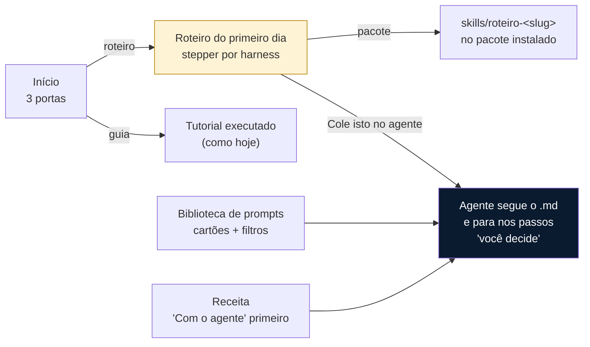
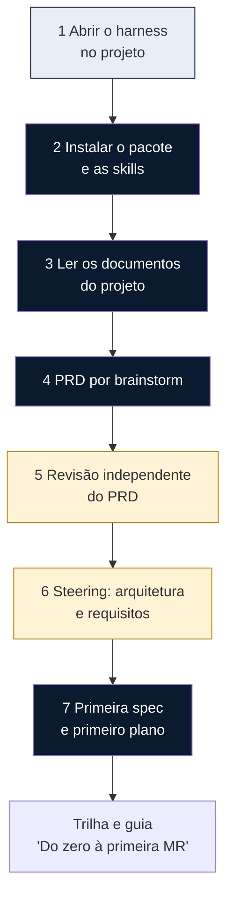
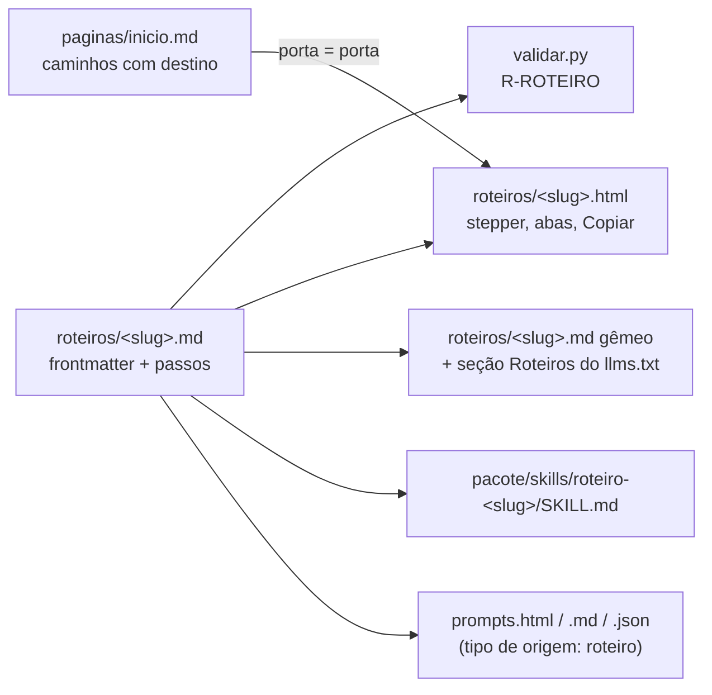

# Spec delta: o primeiro dia com o agente (roteiros, portas, prompts e receitas mais fáceis de usar)

> **Tier:** 2 (tipo de conteúdo novo com schema, template, tema, pacote e validador;
> `esquemas/`, `portal/`, `scripts/` são risco alto).
> **Status:** aprovada
> **Aprovado por:** thiago
> **Aprovado em:** 2026-11-03 (em conversa: "Decide a melhor forma. Manda bronca", depois do
> relato da reunião de piloto)
> **Data:** 2026-11-03
> **Altera:** [`2026-10-01-portal-padroes-engenharia-design.md`](2026-10-01-portal-padroes-engenharia-design.md)
> (§6 modelo de conteúdo, §7.1 Markdown, Início e Biblioteca de prompts),
> [`2026-10-15-trilha-sdd-v3-delta.md`](2026-10-15-trilha-sdd-v3-delta.md) (as três portas da
> Início) e [`2026-10-28-programa-engenharia-de-ia-delta.md`](2026-10-28-programa-engenharia-de-ia-delta.md)
> (trilha D, piloto: este delta é o primeiro item do kit de entrada de um time). O que este
> delta não menciona continua como está naquelas specs.
> **Mockup:** [`2026-11-03-primeiro-dia-mockups/primeiro-dia.html`](2026-11-03-primeiro-dia-mockups/primeiro-dia.html).
> Ele é o teste de aceite visual desta entrega.
> **Origem:** a primeira reunião de piloto com um time de departamento (2026-11-02) e o pedido
> do dono: biblioteca de prompts mais visual, receitas mais fáceis de usar, as três portas da
> Início com algo pronto para o agente, widget de cópia em todo código e um prompt (ou skill) de
> bootstrap do projeto.

## Motivação

Na primeira reunião de piloto, tudo foi feito na hora, ditado por quem conhecia o portal:
instalar as skills (as do pacote e as de terceiros adotadas na trilha), escrever um prompt para o
agente ler as pastas locais com os documentos do projeto, abrir um brainstorm que termina num
PRD, despachar um agente independente para revisar esse PRD, e começar os steerings de
arquitetura e de requisitos. Antes de tudo isso, foi preciso mostrar como abrir o harness no
terminal e como fazer o IDE ler os `.md`. O tempo se perdeu em duas frentes: ninguém sabia a
ordem, e ninguém tinha o texto pronto para colar.

O portal já tem as peças: três portas na Início, dois tutoriais executados de ponta a ponta,
uma receita para instalar skills por harness, um prompt "Com o agente" no fim do guia Brownfield,
a Biblioteca de prompts e o botão Copiar em todo bloco de código. O que falta é o fio: uma
sequência numerada, por harness, em que cada passo diz quem faz, o que colar e onde parar para a
pessoa decidir. E o que existe está escondido: o Copiar só aparece quando a página é servida em
origem segura (em `http://` de intranet o navegador não expõe a área de transferência e o botão
nunca aparece), a Biblioteca é uma lista corrida de textos inteiros, e nas receitas o prompt para
o agente é a quarta seção, depois de três de leitura.

## Decisões

| ID | Decisão |
|---|---|
| PD-D1 | **Tipo de conteúdo novo: `roteiro`.** Um roteiro é a sequência de passos do primeiro dia de um time num projeto, escrita para a pessoa e para o agente ao mesmo tempo. Fonte em `roteiros/<slug>.md`, schema `esquemas/roteiro.schema.json`, página em `roteiros/<slug>.html` com `.md` gêmeo, seção "Roteiros" no `llms.txt`. Risco médio (conteúdo novo), como receita. |
| PD-D2 | **Estrutura do roteiro.** Frontmatter com `titulo`, `objetivo`, `porta` (`projeto-novo`, `projeto-existente` ou `mudanca`), `publico`, `harnesses` (ids de ferramentas de categoria `harness`), `passos` (lista de `{titulo, quem}`), `dominio`, `momento`, `pre_requisitos`, `tempo`, `praticas`, `ferramentas_aprovadas`, `starter`, `resultado_esperado`, `referencias`, `dono`, `revisado_em`. Corpo: um bloco `prompt` antes do primeiro passo (o **prompt inicial**), depois uma seção `## Passo N: Título` por item de `passos`, na mesma ordem e com o mesmo título; dentro de um passo, subseções `### <Título do harness>` opcionais trazem o que muda por harness. A regra `R-ROTEIRO` do validador confere tudo isso. |
| PD-D3 | **Quem faz cada passo** é um de três valores: `voce` (a pessoa faz à mão: abrir o harness, apontar a pasta), `agente` (o agente conduz; a pessoa só observa) e `voce-decide` (o agente prepara e para; a pessoa aprova ou corrige). O prompt inicial diz ao agente para seguir o roteiro pela URL do `.md` e parar nos passos `voce-decide`. |
| PD-D4 | **A página do roteiro é um stepper.** Bloco escuro no topo com o prompt inicial e Copiar ("Cole isto no agente"), depois os passos numerados numa coluna com a marca de quem faz, e abas por harness dentro do passo quando ele tem subseções. A aba escolhida vale para a página inteira e é lembrada no navegador. Sem JavaScript, todas as subseções aparecem, uma depois da outra, com o título do harness. |
| PD-D5 | **O roteiro vira skill no pacote.** Para cada roteiro, o gerador emite `skills/roteiro-<slug>/SKILL.md` no pacote de distribuição, com `name`, `description` (o objetivo) e o corpo do roteiro: os passos com quem faz, as subseções por harness e os prompts. A fonte continua sendo o `.md` do roteiro; nada é escrito em `skills/` do repositório, e o manifesto do pacote cobre a skill gerada como cobre as demais. |
| PD-D6 | **Cada porta da Início ganha o roteiro.** A porta mostra o guia (como hoje) e, quando existe um roteiro com a mesma `porta`, um segundo link "Roteiro com o agente" com os harnesses cobertos. Nada é editado à mão em `paginas/inicio.md`: o casamento é pelo campo `porta`. A porta "No meio de uma mudança" continua levando à trilha e não ganha roteiro nesta entrega. |
| PD-D7 | **Copiar sempre visível.** O botão de todo bloco de código e de todo prompt aparece sem depender da API de área de transferência; sem ela, a cópia usa a seleção do texto e `execCommand("copy")`. O bloco ganha o rótulo da linguagem no canto (`bash`, `yaml`, `prompt`). Nada muda no Markdown de origem. |
| PD-D8 | **Biblioteca de prompts em cartões.** Cada prompt é um cartão com o título da origem (não o slug), chips de domínio, etapa e tipo de origem (prática, receita, roteiro), as duas primeiras linhas do texto, Copiar e "Abrir a origem"; o texto inteiro abre no próprio cartão. Filtros por domínio, etapa e tipo de origem no topo, com a contagem. As saídas `prompts.md` e `prompts.json` seguem iguais, acrescidas dos prompts dos roteiros. |
| PD-D9 | **Receitas: o agente primeiro.** Na página da receita, a seção "Com o agente" sobe para logo abaixo do objetivo, num bloco escuro com Copiar; "Resultado", "Antes de começar", "Passos", "Confira" e "Se der errado" seguem abaixo, sob o título "Prefere fazer à mão?". No índice "Como fazer", cada receita mostra o tempo, as ferramentas e um botão Copiar do prompt. A ordem das seções no `.md` de origem e no `.md` gêmeo não muda. |
| PD-D10 | **Dois roteiros nesta entrega.** `projeto-novo-primeiro-dia` (porta `projeto-novo`), com os passos do relato da reunião, e `projeto-existente-primeiro-dia` (porta `projeto-existente`), que leva ao prompt "Com o agente" do guia Brownfield sem copiá-lo. Os dois cobrem Kiro e Antigravity obrigatoriamente e Claude Code e Codex onde a fonte sustenta. Cada afirmação factual cita `[ref:<id>]` conferido na web, com registro em `verificacoes/`; o que a fonte não sustenta vira instrução para a pessoa, sem afirmação de fato. Nenhum nome de órgão, departamento, pessoa ou sistema de origem. |
| PD-D11 | **Os passos do roteiro de projeto novo** são: 1 Abrir o harness no projeto (`voce`); 2 Instalar o pacote e as skills (`agente`); 3 Ler os documentos do projeto (`agente`); 4 PRD por brainstorm (`agente`: o agente conduz, a pessoa responde); 5 Revisão independente do PRD (`voce-decide`); 6 Steering de arquitetura e de requisitos (`voce-decide`); 7 Primeira spec e primeiro plano (`agente`, que entrega na trilha e no guia "Do zero à primeira MR"). |
| PD-D12 | **Mockup é o teste de aceite visual.** O arquivo em `2026-11-03-primeiro-dia-mockups/` mostra as portas, o roteiro, a Biblioteca e o topo da receita. A revisão final compara as páginas geradas com ele. |
| PD-D13 | **Versão.** Schema aditivo e conteúdo novo: minor. A versão em `portal/config.yml` só muda na tag da release (T2 da Onda 0), então este delta entra em `[Não publicado]` do changelog. |

## O que muda para quem usa

## Quem faz cada passo (roteiro de projeto novo)

Legenda: claro, a pessoa faz; escuro, o agente conduz; âmbar, o agente prepara e a pessoa decide.

## Como o roteiro vira página e skill

## Requisitos

**R1** Existe o tipo `roteiro`, carregado de `roteiros/*.md`, validado por `esquemas/roteiro.schema.json`
com os campos da PD-D2, e com registro de curadoria em `verificacoes/` como os demais conteúdos.
Critério: um roteiro válido passa em `validar.py`; faltar `passos`, `porta` ou `harnesses` reprova
em `R-ESQUEMA`.

**R2** A regra `R-ROTEIRO` reprova: corpo sem o bloco `prompt` antes do primeiro passo; número ou
título de `## Passo N: Título` diferente de `passos`; `### <harness>` cujo título não é o de uma
ferramenta de categoria `harness` listada em `harnesses`; dois roteiros com a mesma `porta`.
Critério: um teste por caso, com a mensagem citando o caminho e a linha.

**R3** A página `roteiros/<slug>.html` segue a PD-D4: bloco escuro com o prompt inicial e Copiar,
passos numerados com a marca de quem faz (`voce`, `agente`, `voce-decide`) e abas por harness onde
há subseções. Critério: o HTML tem um elemento por passo com `data-quem`, um grupo de abas por
passo com subseções, e sem JavaScript todas as subseções ficam visíveis.

**R4** A aba de harness escolhida vale para todos os passos e é lembrada no navegador
(`localStorage`); a página renderiza certo sem armazenamento. Critério: a função no `busca.js`
sincroniza as abas e tolera `localStorage` ausente.

**R5** O `.md` gêmeo do roteiro reproduz o `.md` de origem sem o frontmatter, e o `llms.txt`
ganha a seção "Roteiros". Critério: `llms.txt` lista o roteiro sob "Roteiros".

**R6** O pacote traz `skills/roteiro-<slug>/SKILL.md` por roteiro, com frontmatter `name` e
`description` e o corpo da PD-D5, e o manifesto cobre o arquivo. Critério: `verificar_pacote`
passa; o teste confere o frontmatter e a presença dos sete passos.

**R7** Os prompts dos roteiros entram em `prompts()` com `tipo_origem: roteiro`, com `id`
`roteiro-<slug>-prompt-<n>` e URL com âncora. Critério: teste igual ao das receitas.

**R8** Na Início, cada porta cujo `destino` é um guia mostra também o link "Roteiro com o agente"
para o roteiro de mesma `porta`, com os títulos dos harnesses cobertos; sem roteiro, a porta fica
como hoje. Critério: teste com e sem roteiro.

**R9** O botão Copiar de todo bloco de código e de todo prompt aparece sem depender de
`navigator.clipboard`, com o fallback da PD-D7, e o bloco mostra o rótulo da linguagem. Critério:
o HTML não leva `hidden` no botão; o `busca.js` tem o fallback; o rótulo sai de `info` da cerca.

**R10** A Biblioteca de prompts segue a PD-D8: cartões, filtros por domínio, etapa e tipo de
origem, prévia de duas linhas e texto inteiro no cartão. Critério: o HTML tem `.filtros[data-alvo]`
com três `select[data-filtro]`, um cartão por prompt com `data-dominio`, `data-momento` e
`data-origem`, e o `<pre>` inteiro dentro do cartão.

**R11** A página da receita segue a PD-D9 e o "Como fazer" mostra tempo, ferramentas e Copiar do
prompt por receita. Critério: na página, "Com o agente" vem antes de "Resultado"; no índice, cada
receita tem um `figure.prompt` com `<pre>` e botão.

**R12** Existem os dois roteiros da PD-D10, com os passos da PD-D11 no de projeto novo, curadoria
completa e a receita "Instalar as skills por harness" ligada ao passo 2. Critério: `validar.py` e
`gerar.py` saem com 0; `verificacoes/roteiro-*.yaml` existem; nenhum nome proibido.

**R13** As páginas geradas batem com o mockup da PD-D12 no que ele mostra: portas, stepper, abas,
cartões e topo da receita. Critério: a revisão final da branch compara e registra diferenças.

**R14** ADR 0014 registra o roteiro como tipo de conteúdo e a skill gerada pelo pacote (e não em
`skills/`), e o changelog descreve a entrega em `[Não publicado]`.

## Fora de escopo

- Renderizar Mermaid no portal (R26 do programa).
- Roteiro para a porta "No meio de uma mudança" (PD-D6).
- Reescrever os tutoriais "Do zero à primeira MR" e "Brownfield em 5 passos".
- Um comando no CLI do motor para "instalar o roteiro": a skill gerada já chega pelo pacote.
- Medir o tempo do primeiro dia (KR do programa, Onda 2).

## Esclarecimentos

- 2026-11-03, dono: "ainda não tive feedback" dos times; o roteiro parte do relato da reunião, e o
  piloto mede depois.
- 2026-11-03, dono: "Decide a melhor forma": as decisões PD-D1 a PD-D13 são do autor da spec, com a
  aprovação dada por essa frase. O que o dono discordar volta como delta.
- O prompt inicial de cada roteiro leva `{URL do portal}` como marcador, como os prompts das
  receitas; a receita e o guia já usam essa convenção.
