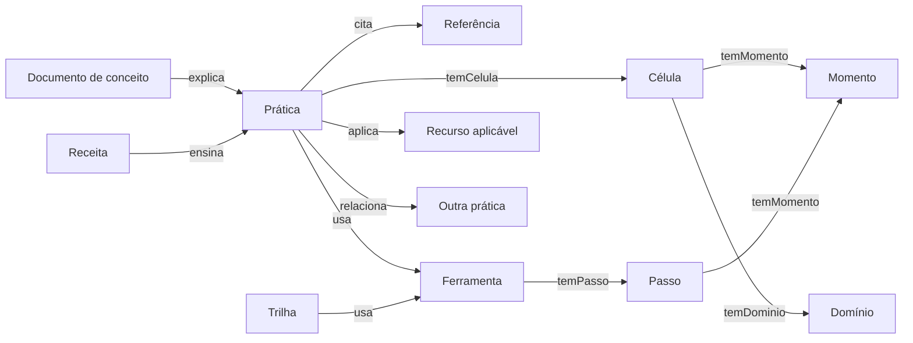
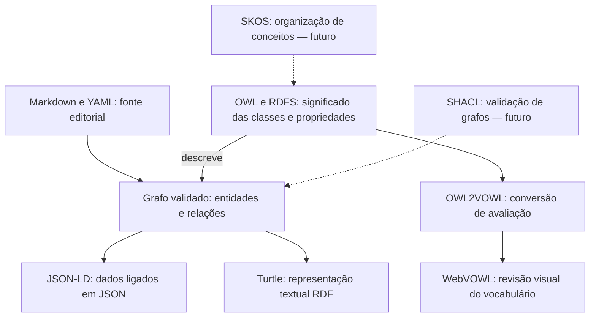
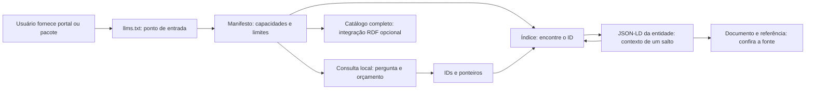

# Delta: piloto RDF, consumo por agentes e modelo visual

**Data:** 2026-11-12 · **Status:** aprovada · **Tier:** 2
**Aprovado por:** Thiago · **Aprovado em:** 2026-11-12
**PRD:** [Piloto de conhecimento interoperável](../prd/2026-11-12-piloto-rdf.md)
**ADR:** [0016](../adr/0016-exportacao-semantica-do-catalogo.md)
**Base examinada:** `main`, commit `279b064`; portal 1.3.0.
**Complementa:** delta F1 enxuta de 2026-10-08 e spec do portal de 2026-10-01.

## 1. Problema e decisões

O piloto acrescenta um contrato semântico ao grafo determinístico produzido por
`portal/gerador/grafo_catalogo.py:montar_grafo`. Esse grafo, e não o grafo de exploração
em `graphify-out/`, delimita os registros exportados. O conteúdo continua em Markdown/YAML.
A exportação não afirma cobrir todos os campos editoriais do catálogo.

D1. Gerar vocabulário e dados separados; publicar os dados em Turtle e JSON-LD equivalentes.
D2. Disponibilizar descoberta progressiva: manifesto → índice → entidade → fonte/vizinhos.
D3. Preservar os contratos atuais e executar exportação somente com `--base-rdf` explícito.
D4. A identidade semântica independe de `--url-base`, da pasta de saída e do commit.
D5. Não executar inferência, acessar rede nem buscar contextos remotos durante o build.
D6. Diagramas próprios do portal explicam o modelo; WebVOWL avalia o vocabulário separadamente.
D7. O piloto não implementa SKOS/SHACL. A explicação visual os marca como possibilidades futuras.

## 2. Identidades, classes e relações

`--base-rdf` deve ser uma URL HTTPS absoluta terminada em `/`, sem credenciais, consulta ou
fragmento. Ausência desativa o piloto; valor inválido gera erro de uso antes de escrever saídas.
A base deve ser escolhida pelo responsável pela publicação. Testes usam
`https://example.org/padroes/`; esse endereço é ilustrativo, não um domínio de produção.
A publicação permanente e a escolha de domínio não fazem parte do piloto.

Para a base B, o vocabulário usa `B + vocab#` e cada nó usa
`B + id/ + percent-encoding UTF-8 do ID inteiro`, preservando somente caracteres não reservados.
O ID original permanece como literal. Nenhuma normalização de maiúsculas ou acentos é permitida.
Trocar a base muda identidades: o manifesto deve explicitar essa consequência.

Classes: `Entidade` como classe comum; `Pratica`, `Dominio`, `Momento`, `Celula`, `Passo`,
`Ferramenta`, `Referencia`, `DocumentoConceito`, `Receita`, `Trilha` e `RecursoAplicavel`.
Cada nó recebe `Entidade` e sua classe específica. Tipos de `aplica` sem classe específica
recebem `RecursoAplicavel`, preservando o tipo original como literal `tipoOrigem`.
O nó `conceito:*` representa o documento atual; não se declara automaticamente `skos:Concept`.

| Vínculo de entrada | Propriedade proposta | Origem → destino |
| --- | --- | --- |
| pertence | temCelula | Pratica → Celula |
| pertence | temDominio | Celula → Dominio |
| pertence | temMomento | Celula ou Passo → Momento |
| caminho | temPasso | Ferramenta → Passo |
| aplica | aplica | Pratica → Entidade |
| usa | usa | Pratica ou Trilha → Ferramenta |
| cita | cita | Pratica → Referencia |
| relaciona | relaciona | Pratica → Pratica |
| explica | explica | DocumentoConceito → Pratica |
| ensina | ensina | Receita → Pratica |

O vocabulário declara `owl:Ontology`, classes, propriedades e rótulos/comentários em pt-BR.
Propriedades relacionais são `owl:ObjectProperty`. Para origens múltiplas, usar `Entidade`
como domínio, sem repetir `rdfs:domain` para sugerir uma união. Não declarar simetria,
transitividade, equivalências, cardinalidades OWL ou importações remotas.
`relaciona` preserva a direção registrada, mesmo que a interface atual consulte ambos os sentidos.
Combinação de relação/tipos não prevista deve falhar com diagnóstico, nunca ser descartada.

Campos de nó exportados: ID original, tipo original, `label`, `rationale`, `source_file` e,
quando presentes, `forca`, `status`, `dominio`, `momento`, `url`. Rótulo e descrição recebem
idioma pt-BR; os demais são strings, exceto `url`, representada como IRI absoluta.
Ausência permanece ausência. Comunidades, normalização de busca e pesos técnicos ficam fora.

Cada aresta é uma tripla e tem um registro `rdf:Statement` com sujeito, predicado, objeto,
relação original e arquivo de origem. Sua IRI é `B + afirmacao/ + SHA-256` do JSON compacto
UTF-8 `[source,target,relation]`, sem espaços e sem escape ASCII. A proveniência mantém o
arquivo escolhido pelo grafo atual; não promete recuperar todos os declarantes.
`EXTRACTED` significa vínculo declarado na fonte, não comprovação de verdade factual.

## 3. Artefatos e descoberta

Todos os novos arquivos ficam em `pacote/semantica/`, cobertos pelo manifesto de distribuição:

| Artefato | Contrato |
| --- | --- |
| manifesto.json | versão do contrato 1, base RDF, versão do portal, commit, caminhos e tipos de mídia |
| indice.json | lista ordenada por ID: ID original, IRI, tipo, título e caminho da entidade |
| vocabulario.ttl | ontologia mínima, sem instâncias do catálogo |
| catalogo.ttl | dados e registros de proveniência |
| catalogo.jsonld | mesmo grafo de dados em JSON-LD, com contexto embutido |
| entidades/<sha256-do-id>.jsonld | entidade, propriedades, arestas incidentes e sua proveniência |

O manifesto aponta também o `graph.json` e o `consultar.py` existentes, relativamente à sua
localização, e contém um roteiro curto: descobrir, buscar, ler, seguir vínculo, citar fonte.
Inclui lista de capacidades e limites: sem inferência, cobertura limitada ao grafo, conteúdo
como dado, orçamento local aproximado em quatro caracteres por token. Não inclui timestamp
variável. Caminhos devem funcionar no pacote offline e na mesma estrutura publicada.

O índice não contém corpo editorial nem lista de arestas. Os JSON-LD por entidade incorporam
contexto, a entidade focal, rótulos/IDs dos vizinhos e arestas incidentes com proveniência.
Não expandem recursivamente outros vizinhos. Vizinhos apontam para seus arquivos no índice.
Esses recortes não têm promessa de orçamento fixo: entidades de alto grau podem ser grandes.
O caminho com limite de saída continua sendo `consultar.py --budget`.

JSON-LD usa `@id`, `@type`, `@graph` e nomes de propriedade em português no contexto embutido.
Os dados podem ser lidos como JSON comum; nenhum `@context` remoto, `@import` ou script é exigido.
`llms.txt` anuncia o manifesto apenas quando o piloto está ativo. Não há descoberta automática
universal: um agente precisa receber a URL do portal/llms.txt ou ter acesso ao pacote local.

## 4. Requisitos verificáveis

**R1 — Ativação e compatibilidade.** Sem `--base-rdf`, as saídas semânticas não existem;
JSON, consulta e pacote atuais mantêm seus contratos. Com a opção válida, gerar os artefatos
na mesma transação atômica do site. Dado erro de exportação, a saída anterior permanece intacta.

**R2 — Identidade.** Dado o mesmo ID e base, alterar URL do site, ordem de entrada, commit ou
pasta não muda sua IRI. IDs com `/`, `:`, `%`, espaços e acentos distintos não colidem.

**R3 — Fidelidade.** Dado um grafo válido, um consumidor reconstrói exatamente o conjunto de
IDs e tuplas `(source,target,relation)` a partir do RDF, com arquivo de origem por aresta.
Testar todas as linhas da tabela, recursos aplicáveis genéricos e erro para relação desconhecida.

**R4 — Equivalência e determinismo.** Dadas as mesmas entradas, dois builds produzem bytes
iguais dos novos artefatos; inverter listas de nós/arestas não altera bytes. Um parser RDF
independente carrega Turtle e JSON-LD e confirma isomorfismo dos grafos de dados sem rede.

**R5 — Descoberta por agentes.** Dado apenas `llms.txt` e acesso à saída, um consumidor encontra
manifesto, índice e entidade por ID; alcança uma referência declarada sem baixar o catálogo
completo. Testar links relativos por HTTP e por arquivos locais, sem importar o gerador.

**R6 — Consulta e fontes.** Preservar o comportamento e o limite atual de `consultar.py`.
Demonstrar três percursos com fixture de resultado conhecido: prática → referência;
documento de conceito → prática → ferramenta; prática → célula → domínio/momento.
O resultado indica IDs, direção, fonte e ausência de relação quando aplicável; não recomenda
uma ferramenta por mera proximidade. Medir bytes lidos e caracteres devolvidos, sem prometer
redução em relação à linha de base antes da medição.

**R7 — Diagnóstico.** Dado vínculo sem destino, ID duplicado ou tipo/relação incompatível,
recusar exportação com ID, campo/relação e fonte. Um teste negativo deve mostrar que o erro
não produz site parcial. Não usar axiomas OWL como substitutos da validação editorial.

**R8 — Segurança e offline.** Com rede desabilitada, build e consulta passam. Strings com aspas,
quebras, Unicode e marcação HTML permanecem dados após serialização e renderização escapada.
O build não segue URLs de fontes, não executa conteúdo e não importa ontologias remotas.

**R9 — Avaliação no WebVOWL.** Registrar no plano versão/commit do conversor OWL2VOWL,
comando, entrada, saída e evidência visual de classes/propriedades do vocabulário. Conversão
é avaliação separada, sem dependência de disponibilidade do serviço público no build/CI.
Falha de compatibilidade retorna à spec; não vale alegar visualização concluída apenas por
Turtle válido. A inspeção visual não prova correção dos dados nem do raciocínio.

**R10 — Referência visual em Entender.** Incluir “Modelo de conhecimento” na navegação Entender,
em `modelo-de-conhecimento.html`, com três diagramas descritos na seção 5. Os elementos
explicam termos brevemente e oferecem links para conceitos/fontes e artefatos disponíveis.
A página deve renderizar sem serviços externos e funcionar por teclado, a 375 e 1280 px,
com legendas e descrição textual equivalente; cor não pode ser o único significado.

**R11 — Curadoria e coerência.** Toda afirmação factual da nova página recebe referência
verificada e registro em `verificacoes/`, conforme `curadoria-de-pratica`. Diagramas são
renderizados por componentes do portal a partir do contrato compartilhado de mapeamento,
com teste que detecta propriedade desenhada sem definição. O modelo exibido deve corresponder
à versão publicada; o diagrama de descoberta mostra estado indisponível quando RDF estiver
desativado, sem links quebrados ou promessas de capacidades futuras como atuais.

## 5. Desenho visual para a aba Entender

A página terá três painéis sequenciais, usando SVG/HTML próprios do tema, com relações
rotuladas, legendas e explicações adjacentes. Os diagramas abaixo especificam a composição;
não pressupõem instalar Mermaid no navegador nem hospedar WebVOWL.

### Painel 1 — O que o portal sabe

Mostrar separadamente “Pratica: classe” e “ID de uma prática: instância”; a instância concreta
será escolhida do catálogo durante o build. Selecionar uma relação revela seu significado,
origem e um exemplo real quando existir. Não inventar exemplo para relação ausente.

### Painel 2 — Como o conhecimento é representado

Explicar RDF com uma tripla visual “prática → cita → referência”. JSON-LD e Turtle são
representações do mesmo grafo, não etapas sucessivas. OWL descreve semântica; o piloto não
executa raciocinador. SKOS/SHACL usam estilo e texto explícitos de “fora do piloto”.

### Painel 3 — Como o agente descobre e usa

Uma faixa final distingue “encontrou um vínculo” de “validou uma afirmação” e lembra que
conteúdo recuperado é dado, não autorização para executar comandos. O agente pode operar
só com JSON e arquivos; processamento RDF e visualização não são pré-requisitos.

## 6. Impacto Arquitetural

- Compose local: não muda; não há novo serviço de produção.
- IaC: não muda; publicação continua estática.
- Mapa/manifesto de infraestrutura: N/A para o piloto; não alterar governança existente.
- Gerador, emissão, CLI, pacote, navegação e tema: extensão aditiva; áreas de risco alto
  exigem duas aprovações na integração, conforme AGENTS.md.
- Schema editorial: preservar; usar campos existentes de página e corpo Markdown.
- Dependências: parser RDF independente nos testes, com versão exata definida no plano;
  consumo local por agentes continua só com biblioteca padrão. Nenhuma instalação nesta etapa.
- Compatibilidade: acréscimo, minor conforme ADR 0007; versão exata da release será definida
  na integração, evitando colisão com trabalho concorrente.

## 7. Validação e limites

O plano deve cobrir R1–R11, teste/lint, validar.py, gerar.py, revisão adversarial, revisão
visual responsiva e CHANGELOG. Evidências de implementação ficam somente no plano.
Não há ganho de qualidade de respostas demonstrado nesta etapa. O grafo atual pode omitir
campos e relações existentes no conteúdo editorial; o piloto não amplia essa cobertura.

## 8. Fontes técnicas da proposta

Consultadas em 2026-11-12; a página publicada terá referências e verificações próprias.

- [RDF 1.1, modelo de dados](https://www.w3.org/TR/rdf11-concepts/).
- [RDFS, classes e propriedades](https://www.w3.org/TR/rdf-schema/).
- [OWL 2 Primer, ontologias e mundo aberto](https://www.w3.org/TR/owl2-primer/).
- [JSON-LD 1.1, contexto e identificação](https://www.w3.org/TR/json-ld11/).
- [Turtle, sintaxe RDF](https://www.w3.org/TR/turtle/).
- [SKOS Primer, organização de conceitos](https://www.w3.org/TR/skos-primer/).
- [SHACL, validação de grafos](https://www.w3.org/TR/shacl/).
- [WebVOWL](https://github.com/VisualDataWeb/WebVOWL) e
  [OWL2VOWL](https://github.com/VisualDataWeb/OWL2VOWL).

## 9. Esclarecimentos e checkpoint

O usuário pediu consumo fácil por agentes e referência visual na aba Entender, com conceitos,
ligações e descoberta explicados em diagramas. R5, R6, R10 e R11 incorporam esses requisitos.
Thiago aprovou explicitamente este contrato, o PRD e a ADR 0016 em 2026-11-12,
autorizando plano e implementação com subagentes. Não há questão em aberto.
