O programa Engenharia de IA tem quatro objetivos, e cada um é medido por resultados-chave (KR). Este
guia lista os KRs, diz o que cada um mede e onde a medida é lida. A coleta é manual, feita pelos
times piloto na tabela do Checkpoint do plano de cada onda. Não há script de coleta neste programa.

## O1. Entregar software de alta qualidade do PRD à produção, com agentes de ponta a ponta

O primeiro objetivo olha o caminho inteiro, da aprovação do PRD ao deploy, e não só a escrita do
código. O DORA, programa de pesquisa sobre desempenho de entrega de software, mede esse desempenho
em duas dimensões, throughput e estabilidade [ref:dora-2024]. Para medir essas duas dimensões, o
programa escolheu quatro métricas, usadas nos KR1.2 e KR1.3: frequência de deploy e lead time, para
o throughput; taxa de falha de mudança e tempo de restauração, para a estabilidade.

| KR | Métrica | Unidade | Onde é medida |
|---|---|---|---|
| KR1.1 | Tempo do PRD aprovado ao primeiro deploy em produção | dias corridos, mediana por projeto | data de aprovação do PRD ou da spec e data do primeiro deploy, na tabela do Checkpoint; onde o piloto não registra a data de aprovação, a série começa na Onda 3 |
| KR1.2 | Frequência de deploy e lead time do commit ao deploy em produção | deploys por semana; horas, mediana | histórico de jobs de deploy do pipeline e git log do piloto, transcritos para a tabela |
| KR1.3 | Taxa de falha de mudança e tempo de restauração | % dos deploys com rollback ou hotfix; horas | registro de incidentes e de rollbacks do piloto (IAC-03, OBS-02), na tabela |

## O2. Reduzir lixo e protótipos que não chegam à produção, e aumentar a produtividade

O segundo objetivo mira o trabalho que não vira produto. A pesquisa de analista de 2025 diz que
menos da metade dos pilotos de IA chega à produção [ref:gartner-pilotos-sem-engenharia-de-ia]; por
isso o KR2.1 mede quantos pilotos têm uma decisão registrada (promover, encerrar ou manter), em vez
de ficarem abandonados.

| KR | Métrica | Unidade | Onde é medida |
|---|---|---|---|
| KR2.1 | Pilotos de IA promovidos ou encerrados por critério declarado, nunca abandonados | % do inventário com decisão (promover, encerrar ou manter) e data | inventário de pilotos por departamento, no Checkpoint |
| KR2.2 | MRs abandonadas por mês | MRs fechadas sem merge por mês, por projeto | lista de MRs do piloto no GitLab ou no GitHub, transcrita para a tabela |
| KR2.3 | Código removido por mês | linhas removidas por mês, por projeto | git log do piloto |

## O3. Integrar sistemas de IA compostos de vários departamentos com um objetivo comum

O terceiro objetivo trata de sistemas que dependem uns dos outros. A medida é quantos têm contrato
versionado num registro compartilhado e quantas integrações passam num eval com traço correlacionado.

| KR | Métrica | Unidade | Onde é medida |
|---|---|---|---|
| KR3.1 | Sistemas de IA com contrato versionado (OpenAPI ou MCP) no registro compartilhado | sistemas, contagem | registro compartilhado dos contratos de IA |
| KR3.2 | Integrações entre departamentos com eval de integração verde e traço correlacionado | integrações, contagem | caso interno sanitizado da integração e o job de eval no CI dos dois projetos |

## O4. Levar as práticas para os agentes: harness corporativo integrado e base de conhecimento única

O quarto objetivo mede se as práticas chegam ao agente e se os projetos usam o mesmo catálogo.

| KR | Métrica | Unidade | Onde é medida |
|---|---|---|---|
| KR4.1 | Práticas instaladas por força em cada projeto piloto | práticas por força (`bloqueia`, `pede-aprovacao`, `avisa`, `orienta`), por projeto | `regras.json` do pacote instalado e saída do `padroes doctor` |
| KR4.2 | Projetos que consultam o catálogo pelo MCP | projetos, contagem; catálogos por lockfile | lockfile dos projetos (`--catalogo`) e relato do time no Checkpoint; telemetria com opt-in (P4) só na Onda 5 |
| KR4.3 | Projetos com `padroes doctor` sem divergência | projetos, contagem | saída do `doctor` colada no Checkpoint |

## Como os objetivos se ligam aos KRs

```mermaid
flowchart TB
    O1["O1 · Entregar software de alta qualidade<br/>do PRD à produção, com agentes de ponta a ponta"]
    O2["O2 · Reduzir lixo e protótipos que não chegam<br/>à produção, e aumentar a produtividade"]
    O3["O3 · Integrar sistemas de IA compostos<br/>de vários departamentos com um objetivo comum"]
    O4["O4 · Levar as práticas para os agentes:<br/>harness corporativo integrado e base única"]
    O1 --> KR11["KR1.1 tempo do PRD aprovado<br/>ao primeiro deploy em produção"]
    O1 --> KR12["KR1.2 frequência de deploy e lead time"]
    O1 --> KR13["KR1.3 taxa de falha e tempo de restauração"]
    O2 --> KR21["KR2.1 pilotos promovidos ou encerrados<br/>por critério declarado, nunca abandonados"]
    O2 --> KR22["KR2.2 MRs abandonadas por mês"]
    O2 --> KR23["KR2.3 código removido por mês"]
    O3 --> KR31["KR3.1 sistemas de IA com contrato versionado<br/>no registro compartilhado"]
    O3 --> KR32["KR3.2 integrações entre departamentos<br/>com eval de integração e traço correlacionado"]
    O4 --> KR41["KR4.1 práticas instaladas por força<br/>em cada projeto piloto"]
    O4 --> KR42["KR4.2 projetos que consultam o catálogo pelo MCP"]
    O4 --> KR43["KR4.3 projetos com doctor sem divergência<br/>e catálogos resolvidos pelo lockfile"]
```

*Figura 1. Os quatro objetivos e os resultados-chave que os medem.*

## Linha de base e metas

Este guia ainda não publica número. A linha de base de cada KR é coletada pelos times piloto na
Onda 0 e publicada aqui ao fim dela, junto com a meta de cada onda. Onde o piloto não registra o
dado hoje, como a data de aprovação do PRD, a série começa mais tarde, como a linha do KR1.1 diz. Os agregados saem sem nome de órgão, departamento, sistema ou pessoa.
